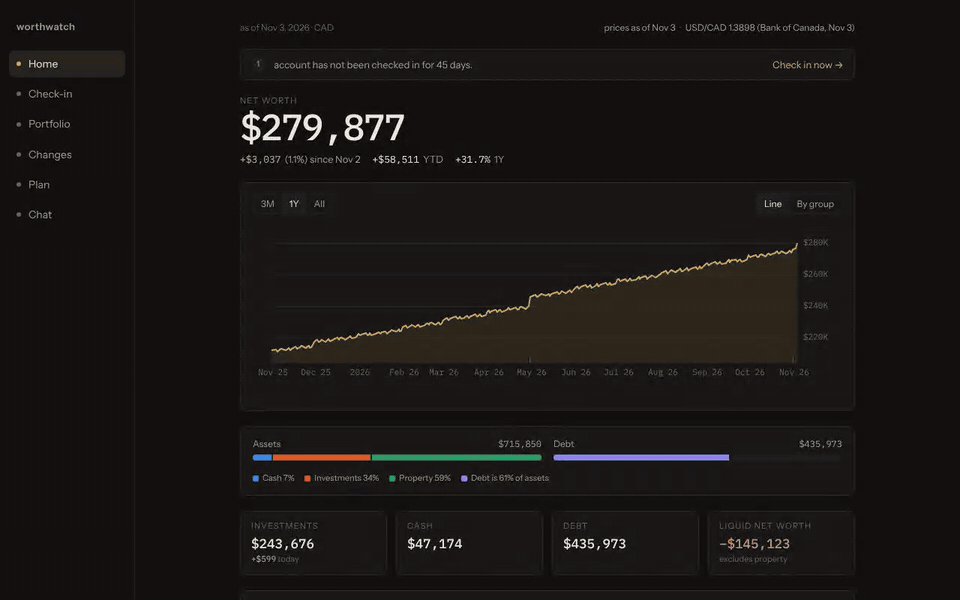
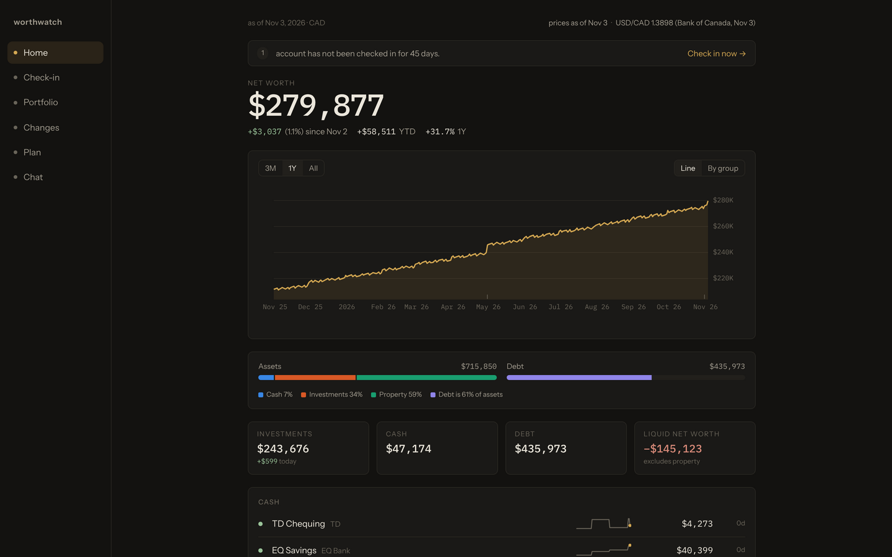
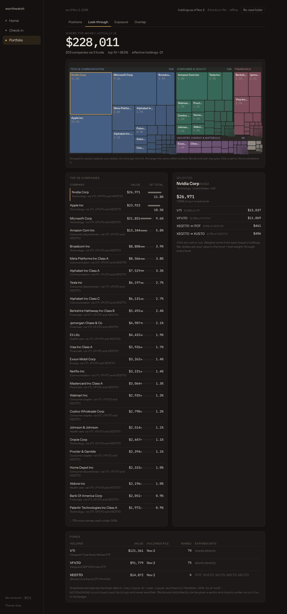
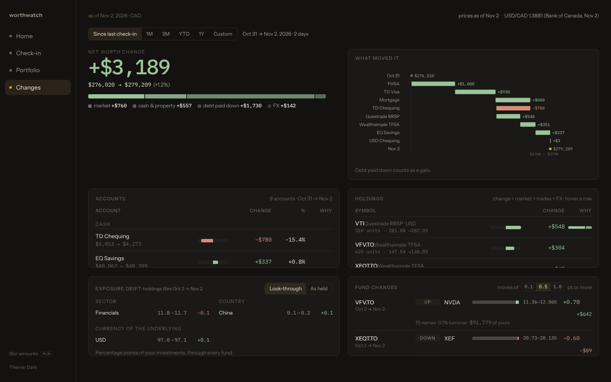
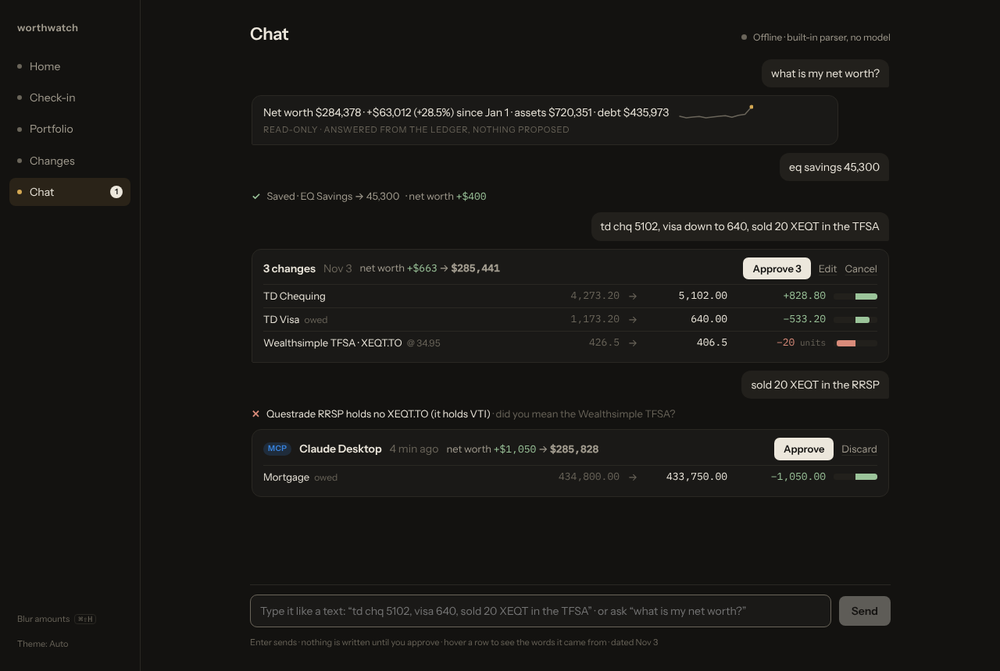
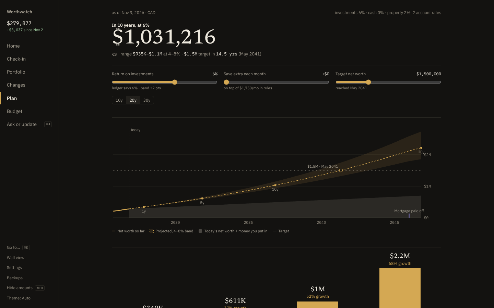
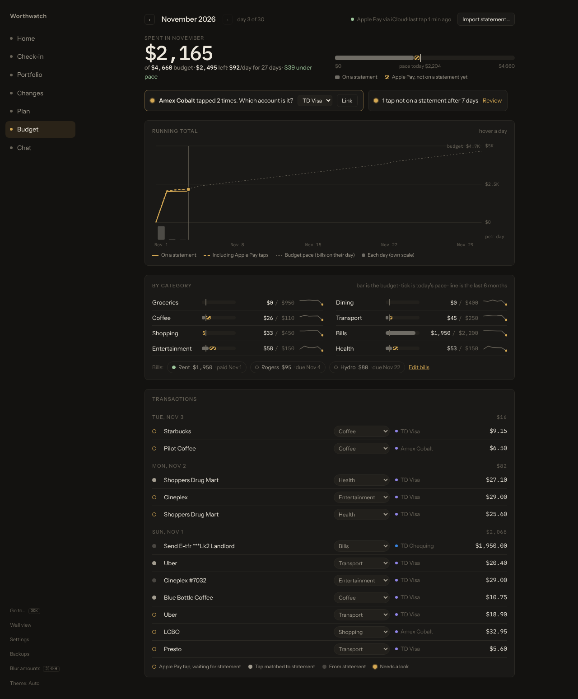
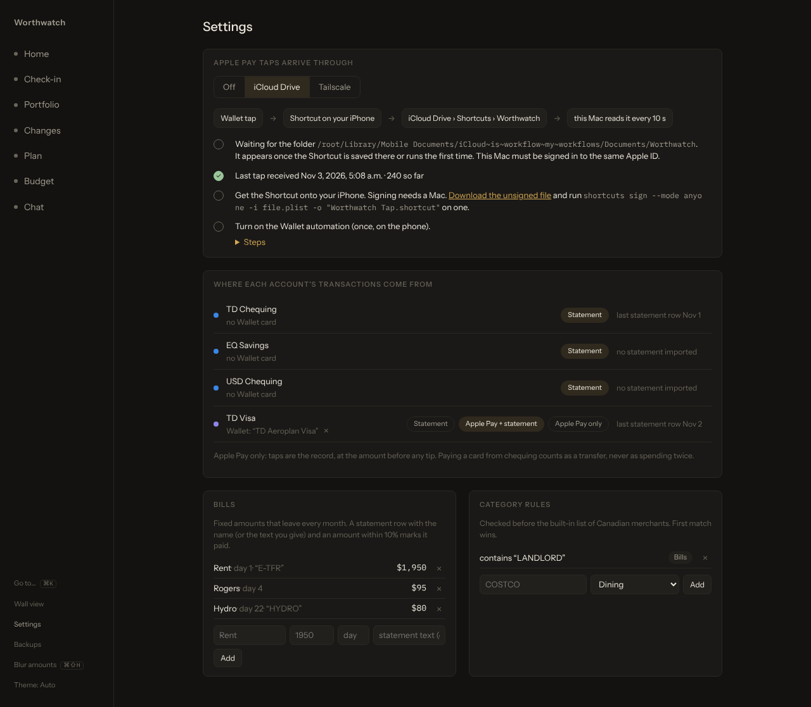

<p align="center">
  <picture>
    <source media="(prefers-color-scheme: light)" srcset="docs/assets/logo-light.svg">
    
  </picture>
</p>

<p align="center">
  <b>Your net worth and portfolio, on your own machine.</b><br>
  One Rust binary. One folder of plain YAML. No bank logins, no cloud account.
</p>

<p align="center">
  <a href="docs/getting-started.md">Get started</a> ·
  <a href="docs/user-guide.md">User guide</a> ·
  <a href="docs/README.md">All docs</a> ·
  <a href="docs/contributing.md">Contributing</a>
</p>

<p align="center">
  
</p>

## What it does

Worthwatch tracks what you own and what you owe. You type balances in once a month, or tell the Chat panel what changed. Worthwatch fetches market prices and exchange rates, values every account in your home currency, and shows where your money actually sits, all the way through the funds you hold.

Everything stays in one folder you can read, edit in a text editor, and back up.

## Features

<table>
  <tr>
    <td width="50%" valign="top">
      <b>📈 Net worth at a glance</b><br>
      A daily net worth line, assets against debt, and every account with a sparkline and the days since you last checked it.<br><br>
      <picture>
        <source media="(prefers-color-scheme: light)" srcset="docs/screenshots/home-light.png">
        
      </picture>
    </td>
    <td width="50%" valign="top">
      <b>🔍 Look through your funds</b><br>
      See the companies inside your ETFs, three levels deep. Break it down by sector, region and currency, and see how much two funds overlap.<br><br>
      <picture>
        <source media="(prefers-color-scheme: light)" srcset="docs/screenshots/lookthrough-light.png">
        
      </picture>
    </td>
  </tr>
  <tr>
    <td width="50%" valign="top">
      <b>↕️ What changed, and why</b><br>
      Pick two dates. Worthwatch splits the change into market moves, money you added and currency swings, then lists what your funds bought and sold.<br><br>
      <picture>
        <source media="(prefers-color-scheme: light)" srcset="docs/screenshots/changes-light.png">
        
      </picture>
    </td>
    <td width="50%" valign="top">
      <b>💬 Update it like a text message</b><br>
      Type <code>td chq 6000, visa 640, bought 10 xeqt</code> and approve the card. Nothing is saved until you do. Works with a local model, Claude, or no model.<br><br>
      <picture>
        <source media="(prefers-color-scheme: light)" srcset="docs/screenshots/chat-light.png">
        
      </picture>
    </td>
  </tr>
  <tr>
    <td width="50%" valign="top">
      <b>🧭 Plan ahead</b><br>
      Project net worth from your recurring deposits and payments, see when each debt is paid off, and track TFSA, RRSP and FHSA room.<br><br>
      <picture>
        <source media="(prefers-color-scheme: light)" srcset="docs/screenshots/plan-light.png">
        
      </picture>
    </td>
    <td width="50%" valign="top">
      <b>🖥️ Wall view, ⌘K and daily backups</b><br>
      A full-screen view for a spare tablet, a command palette for every screen and action, and a backup of your data every day.<br><br>
      <picture>
        <source media="(prefers-color-scheme: light)" srcset="docs/screenshots/wall-light.png">
        
      </picture>
    </td>
  </tr>
  <tr>
    <td width="50%" valign="top">
      <b>🧾 Budget from your statements</b><br>
      Import CSV or OFX from any Canadian bank. Spending sorts into categories, bills tick off as they're paid, and a running total shows if you're on pace.<br><br>
      <picture>
        <source media="(prefers-color-scheme: light)" srcset="docs/screenshots/budget-light.png">
        
      </picture>
    </td>
    <td width="50%" valign="top">
      <b>📲 Apple Pay, the moment you tap</b><br>
      A Shortcut on your iPhone sends each Wallet purchase to your Mac through iCloud Drive or Tailscale. Your statement confirms it later, never counting it twice.<br><br>
      <picture>
        <source media="(prefers-color-scheme: light)" srcset="docs/screenshots/settings-light.png">
        
      </picture>
    </td>
  </tr>
</table>

## Quick start

### Docker

```sh
git clone https://github.com/Akazai-A/Worthwatch.git && cd Worthwatch
docker compose -f deploy/docker-compose.yml up -d --build
```

Open <http://127.0.0.1:7777>. To look around with sample data first, run:

```sh
docker compose -f deploy/docker-compose.yml exec worthwatch /worthwatch seed --force
```

### Binary

You need Rust (stable) and Node.js 22 with pnpm.

```sh
git clone https://github.com/Akazai-A/Worthwatch.git && cd Worthwatch
pnpm --dir ui install && pnpm --dir ui build
cargo run --release
```

Open <http://127.0.0.1:7777>. Your data goes to `./data`. Run `cargo run --release -- seed` to load sample data.

### Mac

To run it in the background on a Mac mini, starting at login:

```sh
git clone https://github.com/Akazai-A/Worthwatch.git && cd Worthwatch
./deploy/macos/install.sh
```

See [Run Worthwatch on a Mac](docs/macos.md).

For the full setup, your first check-in, and where your data lives, see [Get started](docs/getting-started.md).

## Private by default

- 🔒 **Localhost only.** Worthwatch listens on `127.0.0.1`. Nothing else on your network can reach it until you [choose to allow it](docs/remote-access.md).
- 📄 **Your data is a text file.** Accounts and balances live in `ledger.yaml`. Edit it by hand and the app reloads.
- 🌐 **It fetches public prices only.** Yahoo Finance, Stooq and the Bank of Canada. It never sees your balances. Set `WORTHWATCH_OFFLINE=1` to turn fetching off.
- ✋ **Models propose, you approve.** Chat and Claude Desktop can suggest changes. Only your click writes them.

> [!WARNING]
> Worthwatch has no login yet. Anyone who can reach the port sees everything. For access away from home, use [Tailscale](docs/remote-access.md), not port forwarding.

## Documentation

| Guide | What you learn |
|---|---|
| [Get started](docs/getting-started.md) | Install with Docker or from source, load sample data, do your first check-in. |
| [User guide](docs/user-guide.md) | Use each screen: Home, Check-in, Portfolio, Changes, Chat, Plan, Budget, Wall view. |
| [Budget your spending](docs/budgeting.md) | Import bank statements, set limits, sort categories, track bills. |
| [Set up the Apple Pay feed](docs/apple-pay-feed.md) | Send each Wallet purchase from your iPhone to your Mac as you pay. |
| [Configure Worthwatch](docs/configuration.md) | Settings in `ledger.yaml` and environment variables. |
| [Prices, FX and fund holdings](docs/data-sources.md) | Where numbers come from and how to override them. |
| [Connect Claude Desktop](docs/mcp.md) | Ask Claude about your portfolio and propose updates through MCP. |
| [Access Worthwatch remotely](docs/remote-access.md) | Reach it from your phone with Tailscale, or open it on your network. |
| [Back up and restore](docs/backup-restore.md) | Daily backups, manual backups, and restoring onto a new machine. |
| [Run Worthwatch on a Mac](docs/macos.md) | Start it at login on a Mac mini with one install script. |
| [Architecture](docs/architecture.md) | How the server, the ledger and the UI fit together. |
| [Contribute](docs/contributing.md) | Build, test and send a change. |

## Built with

Rust ([Axum](https://github.com/tokio-rs/axum), `rust_decimal`), [Svelte 5](https://svelte.dev) and Vite, [uPlot](https://github.com/leeoniya/uPlot) and d3-hierarchy for charts.
