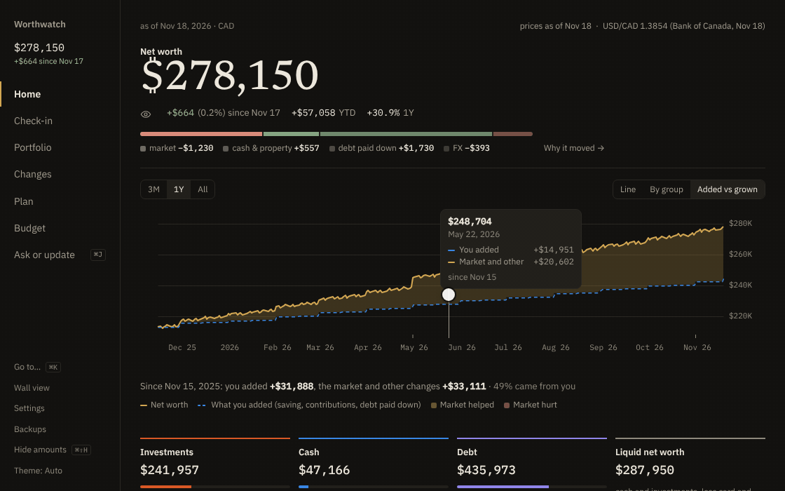
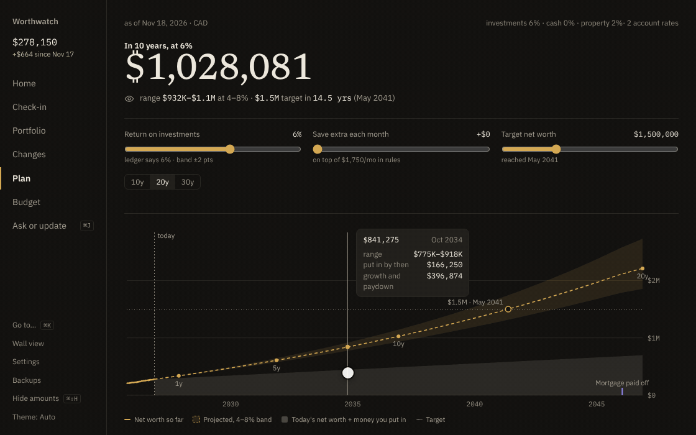
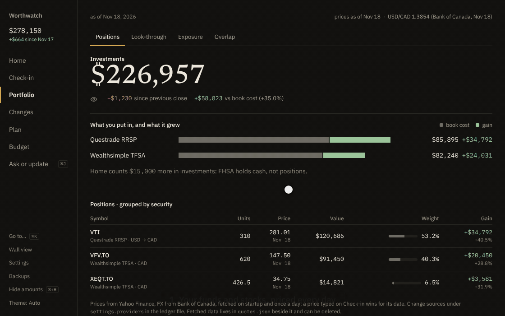
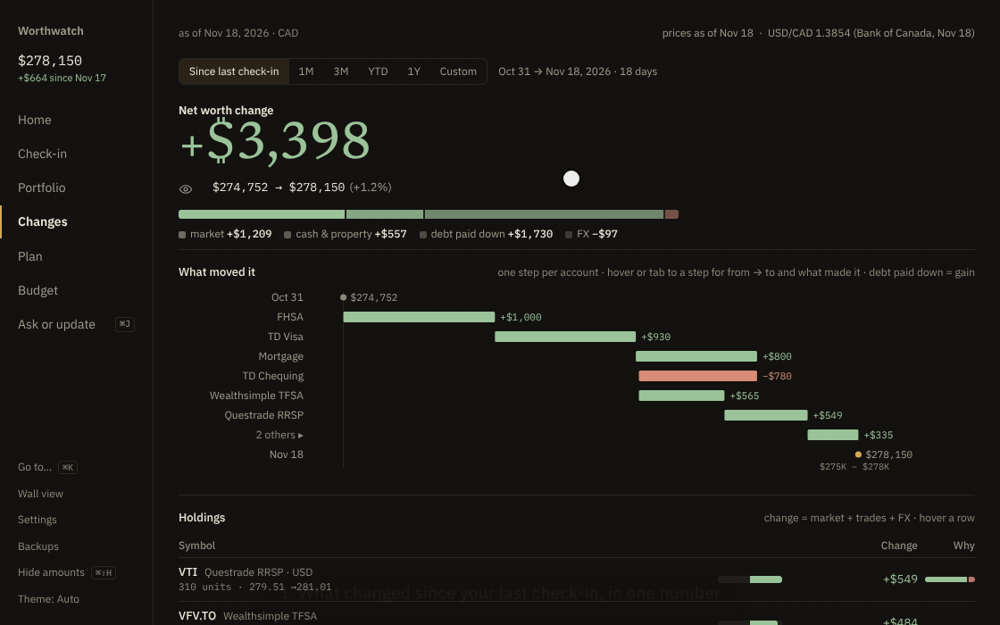
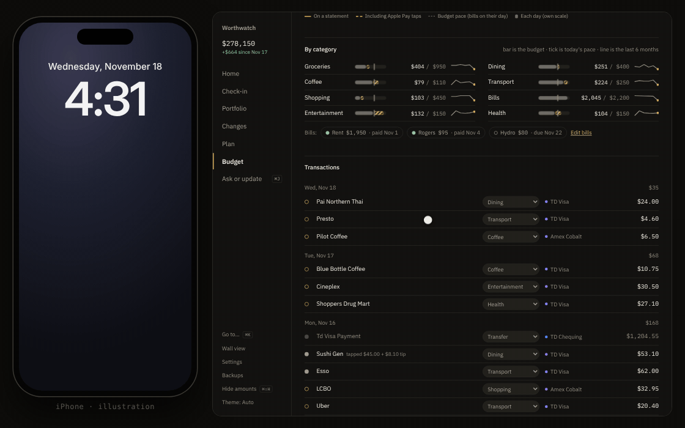
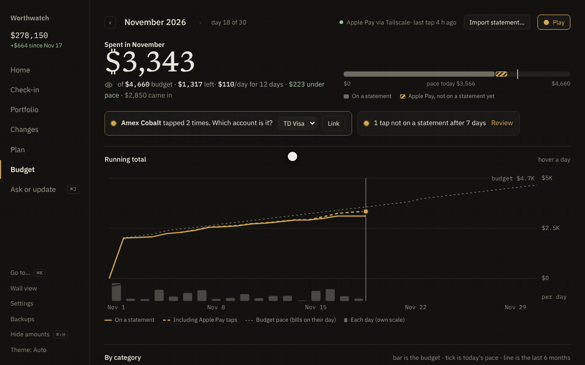

<p align="center">
  <picture>
    <source media="(prefers-color-scheme: light)" srcset="docs/assets/logo-light.svg">
    
  </picture>
</p>

<p align="center">
  <b>Your net worth and portfolio, on your own machine.</b><br>
  One Rust binary. One folder of plain YAML. No bank logins, no cloud account.
</p>

<p align="center">
  <a href="#quick-start">Quick start</a> ·
  <a href="docs/use/getting-started.md">Get started</a> ·
  <a href="docs/use/user-guide.md">User guide</a> ·
  <a href="docs/README.md">All docs</a> ·
  <a href="docs/develop/contributing.md">Contributing</a>
</p>

## What it does

Worthwatch tracks what you own and what you owe. You type balances in once a month, or tell Chat what changed. It fetches prices and exchange rates, values everything in your home currency, and shows where your money sits, right through the funds you hold. Everything stays in one folder of plain files.

## Features

### 📈 Every account, always current

All your accounts in one net worth, measured against what you actually put in. Type changes like a text, approve the card, and every screen updates. Recurring rules carry your plan forward.

<table>
  <tr>
    <td width="50%" valign="top">
      <br>
      <b>Update it like a text</b><br>
      <sub>Approve the card and net worth updates live.</sub>
    </td>
    <td width="50%" valign="top">
      <br>
      <b>Plan ahead</b><br>
      <sub>Drag a slider to see your target date, payoff and TFSA, RRSP and FHSA room.</sub>
    </td>
  </tr>
</table>

[Home](docs/use/user-guide.md#home) · [Chat](docs/use/user-guide.md#chat) · [Plan](docs/use/user-guide.md#plan)

### 🔍 See inside your investments

Worthwatch follows each ETF down to the companies it holds, so you see what you really own and where funds overlap. Changes splits any period into market moves, money you added, debt paid down and FX.

<table>
  <tr>
    <td width="50%" valign="top">
      <br>
      <b>Look through your funds</b><br>
      <sub>By company, sector, country and currency, plus fund overlap.</sub>
    </td>
    <td width="50%" valign="top">
      <br>
      <b>What changed, and why</b><br>
      <sub>Each account and holding's share of the move.</sub>
    </td>
  </tr>
</table>

[Portfolio](docs/use/user-guide.md#portfolio) · [Changes](docs/use/user-guide.md#changes) · [Fund holdings](docs/use/data-sources.md)

### 🎯 Budget from your iPhone, and play it

Each Apple Pay tap reaches your Mac as you pay, and your bank statement confirms it later, so nothing counts twice. No bank login is involved. The budget game turns the month into a board: unspent allowance fills a jar toward your goal.

<table>
  <tr>
    <td width="50%" valign="top">
      <br>
      <b>Budget, with Apple Pay</b><br>
      <sub>Your iPhone tells you what's left today.</sub>
    </td>
    <td width="50%" valign="top">
      <br>
      <b>Play the month</b><br>
      <sub>Daily allowances, a jar goal and weekly challenge cards.</sub>
    </td>
  </tr>
</table>

[Budget](docs/use/budgeting.md) · [Apple Pay feed](docs/use/apple-pay-feed.md) · [Budget game](docs/use/budget-game.md)

Also: a [wall view](docs/use/user-guide.md#wall-view) for a spare tablet, a <kbd>⌘</kbd> <kbd>K</kbd> command palette, and [daily backups](docs/run/backup-restore.md).

## Works with your AI assistant

Worthwatch includes an [MCP](https://modelcontextprotocol.io) server. Run `worthwatch mcp` from any MCP client that can start a local command, such as Claude Desktop, Claude Code or Cursor. Your assistant can then:

- Answer questions such as "How much of my money is in US tech?" from your real numbers.
- Propose updates, such as "Visa is down to 640". Each proposal waits in Chat until you select **Approve**.

The assistant never writes to your ledger directly. To set it up, see [Connect an AI assistant](docs/run/mcp.md).

## Quick start

### Docker

```sh
git clone https://github.com/Akazai-A/Worthwatch.git && cd Worthwatch
docker compose -f deploy/docker-compose.yml up -d --build
```

Open <http://127.0.0.1:7777>. To look around with sample data first, run:

```sh
docker compose -f deploy/docker-compose.yml exec worthwatch /worthwatch seed --force
```

### Binary

You need Rust (stable) and Node.js 22 with pnpm.

```sh
git clone https://github.com/Akazai-A/Worthwatch.git && cd Worthwatch
pnpm --dir ui install && pnpm --dir ui build
cargo run --release
```

Open <http://127.0.0.1:7777>. Your data goes to `./data`. Run `cargo run --release -- seed` to load sample data.

### Mac

To run it in the background on a Mac mini, starting at login:

```sh
git clone https://github.com/Akazai-A/Worthwatch.git && cd Worthwatch
./deploy/macos/install.sh
```

See [Run Worthwatch on a Mac](docs/run/macos.md).

For the full setup, your first check-in, and where your data lives, see [Get started](docs/use/getting-started.md).

## Private by default

- 🔒 **Localhost only.** Worthwatch listens on `127.0.0.1`. Nothing else on your network can reach it until you [choose to allow it](docs/run/remote-access.md). It refuses requests from other websites, and over Tailscale answers only the Apple Pay feed until you name your login. See [Keep Worthwatch secure](docs/run/security.md).
- 📄 **Your data is a text file.** Accounts and balances live in `ledger.yaml`. Edit it by hand and the app reloads.
- 🌐 **It fetches public prices only.** Yahoo Finance, Stooq and the Bank of Canada. It never sees your balances. Set `WORTHWATCH_OFFLINE=1` to turn fetching off.
- ✋ **Models propose, you approve.** Chat and MCP clients can suggest changes. Only your click writes them.

> [!WARNING]
> Worthwatch has no login yet. Anyone who can reach the port sees everything. For access away from home, use [Tailscale](docs/run/remote-access.md), not port forwarding. To run it isolated in a container on a spare Mac, follow [Keep Worthwatch secure](docs/run/security.md).

## Documentation

| Guide | What you learn |
|---|---|
| [Get started](docs/use/getting-started.md) | Install with Docker or from source, load sample data, do your first check-in. |
| [User guide](docs/use/user-guide.md) | Use each screen: Home, Check-in, Portfolio, Changes, Chat, Plan, Budget, Wall view. |
| [Budget your spending](docs/use/budgeting.md) | Import bank statements, set limits, sort categories, track bills. |
| [Play the budget game](docs/use/budget-game.md) | Beat a daily allowance, fill a jar to your monthly goal, and get a notification after each tap. |
| [Set up the Apple Pay feed](docs/use/apple-pay-feed.md) | Send each Wallet purchase from your iPhone to your Mac as you pay. |
| [Configure Worthwatch](docs/use/configuration.md) | Settings in `ledger.yaml` and environment variables. |
| [Prices, FX and fund holdings](docs/use/data-sources.md) | Where numbers come from and how to override them. |
| [Connect an AI assistant](docs/run/mcp.md) | Use Claude Desktop, Claude Code or another MCP client with your data. |
| [Keep Worthwatch secure](docs/run/security.md) | Run it in a container, send taps over Tailscale, and check it's locked down. |
| [Access Worthwatch remotely](docs/run/remote-access.md) | Reach it from your phone with Tailscale, or open it on your network. |
| [Back up and restore](docs/run/backup-restore.md) | Daily backups, manual backups, and restoring onto a new machine. |
| [Run Worthwatch on a Mac](docs/run/macos.md) | Start it at login on a Mac mini with one install script. |
| [Architecture](docs/develop/architecture.md) | How the server, the ledger and the UI fit together. |
| [Contribute](docs/develop/contributing.md) | Build, test and send a change. |

## Built with

Rust ([Axum](https://github.com/tokio-rs/axum), `rust_decimal`), [Svelte 5](https://svelte.dev) and Vite, [uPlot](https://github.com/leeoniya/uPlot) and d3-hierarchy for charts.
