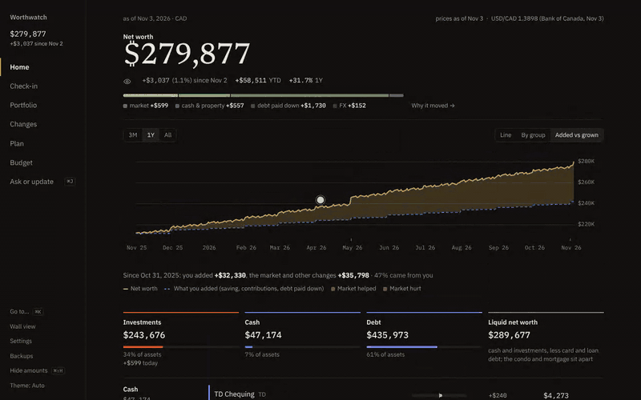
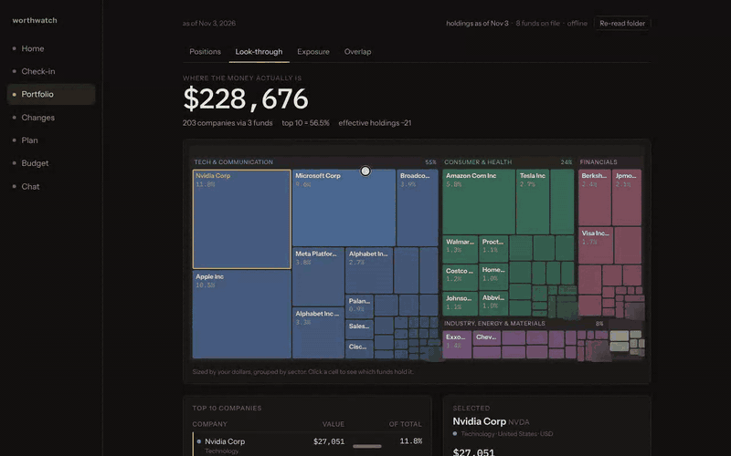
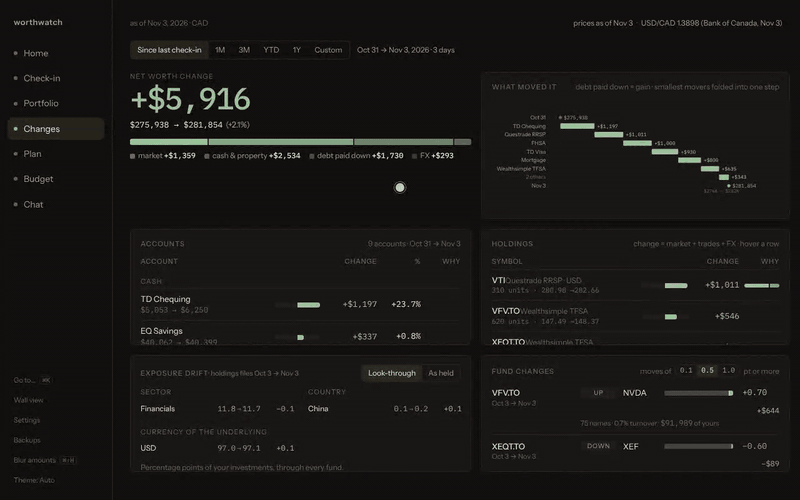
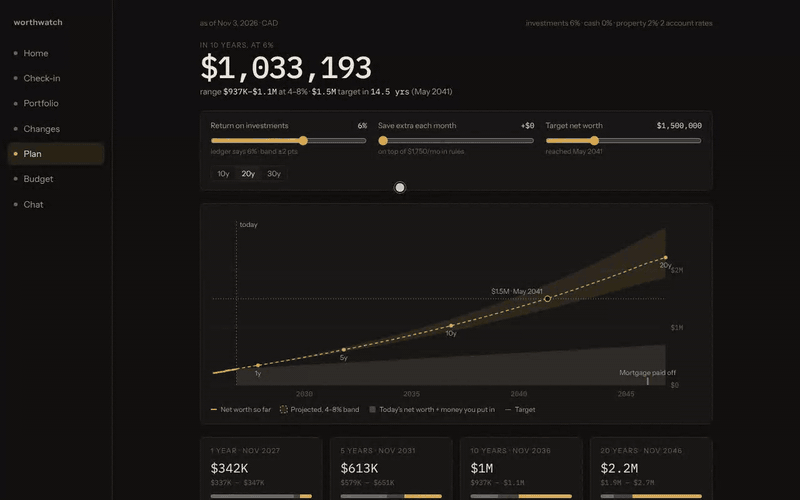
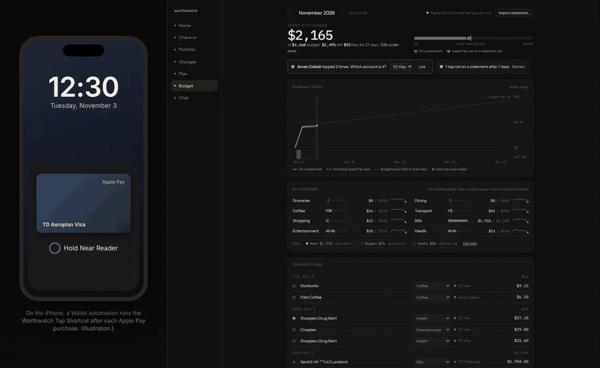
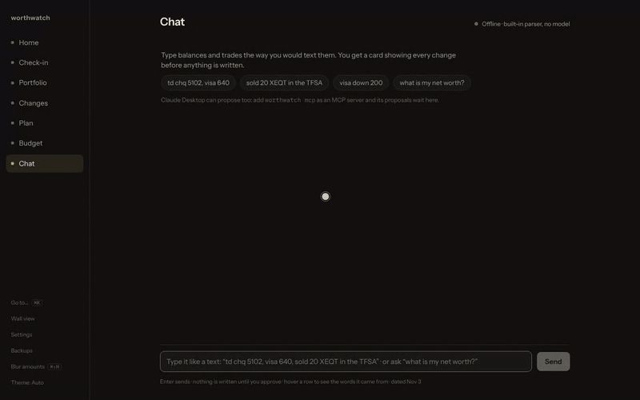
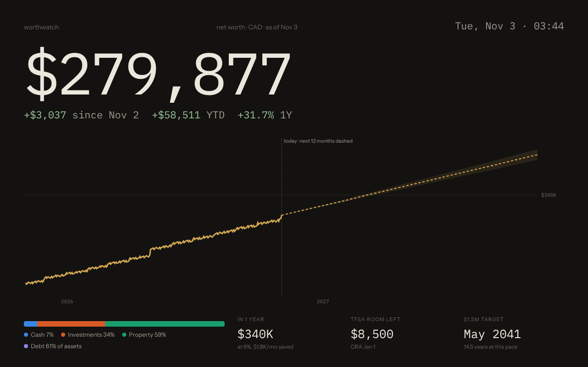

<p align="center">
  <picture>
    <source media="(prefers-color-scheme: light)" srcset="docs/assets/logo-light.svg">
    
  </picture>
</p>

<p align="center">
  <b>Your net worth and portfolio, on your own machine.</b><br>
  One Rust binary. One folder of plain YAML. No bank logins, no cloud account.
</p>

<p align="center">
  <a href="#quick-start">Quick start</a> ·
  <a href="docs/getting-started.md">Get started</a> ·
  <a href="docs/user-guide.md">User guide</a> ·
  <a href="docs/README.md">All docs</a> ·
  <a href="docs/contributing.md">Contributing</a>
</p>

<p align="center">
  <picture>
    <source media="(prefers-color-scheme: light)" srcset="docs/screenshots/hero-light.png">
    
  </picture>
</p>

## What it does

Worthwatch tracks what you own and what you owe. You type balances in once a month, or tell the Chat panel what changed. Worthwatch fetches market prices and exchange rates, values every account in your home currency, and shows where your money actually sits, all the way through the funds you hold.

Everything stays in one folder you can read, edit in a text editor, and back up.

## Features

### 📈 Net worth at a glance

A daily net worth line, assets against debt, and every account with a sparkline. Once a month, type your balances on Check-in and watch the total move. [Learn more](docs/user-guide.md#home).

<p align="center"></p>

### 🔍 Look through your funds

See the companies inside your ETFs, three levels deep. Break your money down by sector, region and currency, and see how much two funds overlap. [Learn more](docs/user-guide.md#portfolio).

<p align="center"></p>

### ↕️ What changed, and why

Pick a period. Worthwatch splits the change into market moves, money you added, debt paid down and currency swings, then lists what your funds bought and sold. [Learn more](docs/user-guide.md#changes).

<p align="center"></p>

### 🧭 Plan ahead

Project net worth from your recurring deposits and payments. Drag a slider to try another return or more saving, and see when each debt is paid off. [Learn more](docs/user-guide.md#plan).

<p align="center"></p>

### 📲 Budget, with Apple Pay the moment you tap

Import statements from any Canadian bank, set limits per category, and track bills. With the iPhone Shortcut, each Apple Pay purchase appears on Budget as you pay, and the statement confirms it later without counting it twice. [Learn more](docs/apple-pay-feed.md).

<p align="center"></p>

### 💬 Update it like a text message

Type <code>td chq 6000, visa 640, bought 10 xeqt</code>. You get a card with every change and its effect on net worth. Nothing is saved until you approve. Works with a local model, Claude, or no model at all. [Learn more](docs/user-guide.md#chat).

<p align="center"></p>

### And more

<table>
  <tr>
    <td width="50%" valign="top">
      <b>🧾 Budget from your statements</b><br>
      CSV or OFX from any Canadian bank, your own category rules, bills that tick off, and a pace line.<br><br>
      <picture>
        <source media="(prefers-color-scheme: light)" srcset="docs/screenshots/budget-light.png">
        
      </picture>
    </td>
    <td width="50%" valign="top">
      <b>🖥️ Wall view, ⌘K and daily backups</b><br>
      A full-screen view for a spare tablet, a command palette for every screen, and a backup every day.<br><br>
      <picture>
        <source media="(prefers-color-scheme: light)" srcset="docs/screenshots/wall-light.png">
        
      </picture>
    </td>
  </tr>
</table>

## Works with your AI assistant

Worthwatch includes an [MCP](https://modelcontextprotocol.io) server. Run `worthwatch mcp` from any MCP client that can start a local command, such as Claude Desktop, Claude Code or Cursor. Your assistant can then:

- Answer questions such as "How much of my money is in US tech?" from your real numbers.
- Propose updates, such as "Visa is down to 640". Each proposal waits in Chat until you select **Approve**.

The assistant never writes to your ledger directly. To set it up, see [Connect an AI assistant](docs/mcp.md).

## Quick start

### Docker

```sh
git clone https://github.com/Akazai-A/worthwatch.git && cd worthwatch
docker compose -f deploy/docker-compose.yml up -d --build
```

Open <http://127.0.0.1:7777>. To look around with sample data first, run:

```sh
docker compose -f deploy/docker-compose.yml exec worthwatch /worthwatch seed --force
```

### Binary

You need Rust (stable) and Node.js 22 with pnpm.

```sh
git clone https://github.com/Akazai-A/worthwatch.git && cd worthwatch
pnpm --dir ui install && pnpm --dir ui build
cargo run --release
```

Open <http://127.0.0.1:7777>. Your data goes to `./data`. Run `cargo run --release -- seed` to load sample data.

### Mac

To run it in the background on a Mac mini, starting at login:

```sh
git clone https://github.com/Akazai-A/worthwatch.git && cd worthwatch
./deploy/macos/install.sh
```

See [Run Worthwatch on a Mac](docs/macos.md).

For the full setup, your first check-in, and where your data lives, see [Get started](docs/getting-started.md).

## Private by default

- 🔒 **Localhost only.** Worthwatch listens on `127.0.0.1`. Nothing else on your network can reach it until you [choose to allow it](docs/remote-access.md).
- 📄 **Your data is a text file.** Accounts and balances live in `ledger.yaml`. Edit it by hand and the app reloads.
- 🌐 **It fetches public prices only.** Yahoo Finance, Stooq and the Bank of Canada. It never sees your balances. Set `WORTHWATCH_OFFLINE=1` to turn fetching off.
- ✋ **Models propose, you approve.** Chat and MCP clients can suggest changes. Only your click writes them.

> [!WARNING]
> Worthwatch has no login yet. Anyone who can reach the port sees everything. For access away from home, use [Tailscale](docs/remote-access.md), not port forwarding.

## Documentation

| Guide | What you learn |
|---|---|
| [Get started](docs/getting-started.md) | Install with Docker or from source, load sample data, do your first check-in. |
| [User guide](docs/user-guide.md) | Use each screen: Home, Check-in, Portfolio, Changes, Chat, Plan, Budget, Wall view. |
| [Budget your spending](docs/budgeting.md) | Import bank statements, set limits, sort categories, track bills. |
| [Set up the Apple Pay feed](docs/apple-pay-feed.md) | Send each Wallet purchase from your iPhone to your Mac as you pay. |
| [Configure Worthwatch](docs/configuration.md) | Settings in `ledger.yaml` and environment variables. |
| [Prices, FX and fund holdings](docs/data-sources.md) | Where numbers come from and how to override them. |
| [Connect an AI assistant](docs/mcp.md) | Use Claude Desktop, Claude Code or another MCP client with your data. |
| [Access Worthwatch remotely](docs/remote-access.md) | Reach it from your phone with Tailscale, or open it on your network. |
| [Back up and restore](docs/backup-restore.md) | Daily backups, manual backups, and restoring onto a new machine. |
| [Run Worthwatch on a Mac](docs/macos.md) | Start it at login on a Mac mini with one install script. |
| [Architecture](docs/architecture.md) | How the server, the ledger and the UI fit together. |
| [Contribute](docs/contributing.md) | Build, test and send a change. |

## Built with

Rust ([Axum](https://github.com/tokio-rs/axum), `rust_decimal`), [Svelte 5](https://svelte.dev) and Vite, [uPlot](https://github.com/leeoniya/uPlot) and d3-hierarchy for charts.
