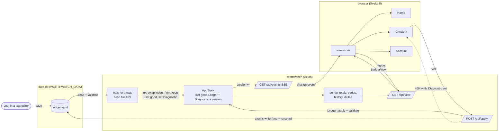
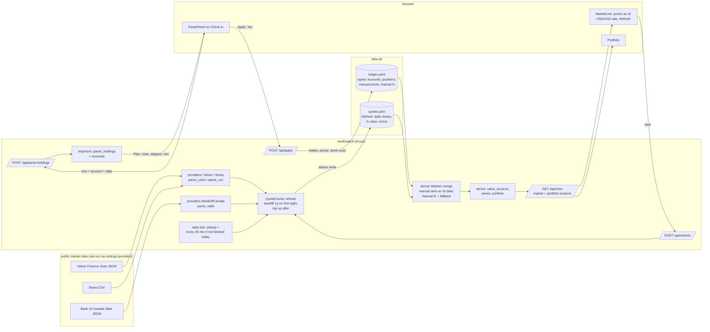
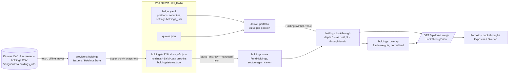
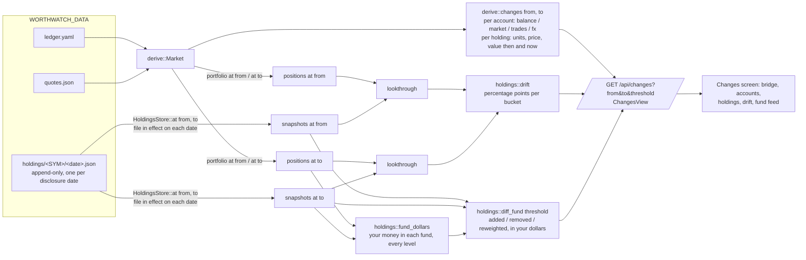

# Architecture (Stage 5)

Read the design doc for the full picture. The rules that matter in code:

1. **One write path.** Every change is a `ledger::Mutation` applied by `Ledger::apply`, which returns a new `Ledger`. `server::state::AppState::apply_many` is the only thing that writes `ledger.yaml`, and it writes atomically (temp file + rename).
2. **Core is pure.** `crates/ledger` and `crates/derive` do no IO except `ledger::io`, and never read the clock. Dates come in as arguments.
3. **Exact numbers.** `rust_decimal::Decimal` for money, `chrono::NaiveDate` for dates. No `f64` outside chart payloads.
4. **One view per screen.** `server::routes::LedgerView` is assembled server-side; the UI renders it and never recomputes totals.
5. **The file is the truth, even when broken.** `server::state` polls `ledger.yaml` (mtime + size, 4×/s; polling so Docker bind mounts work) and reloads it. A file that fails to parse or validate leaves the last good `Ledger` in memory, sets a `Diagnostic` (line number when the YAML parser gave one), and makes `apply` refuse with 409 until the file is fixed, so a hand edit is never overwritten. Changes fan out to the UI over `/api/events` (SSE) and the UI re-fetches `/api/view`.
6. **Dependency direction.** `ui -> server -> derive -> ledger`, with `providers`, `holdings`, `importers` and `assistant` as siblings the server glues in (`importers -> ledger`; `assistant -> ledger`; `providers -> holdings`; `holdings` depends on nothing in the workspace). Nothing below `server` knows about HTTP.
7. **Two files, two kinds of data.** `ledger.yaml` holds what you would type: accounts, balances, positions, prices and FX rates you entered. `quotes.json` beside it holds what the app fetched. It is never hand-edited and can be deleted; the next refresh rebuilds it. `derive::Market` merges the two for valuation: a typed price wins over a fetched one for the same date, and a typed FX rate is the fallback when no fetched rate covers the date.
8. **Providers at the boundary only.** `PriceProvider` and `FxProvider` are the only traits; each has a `Manual` (fixed answers) and `Off` impl, and every real provider is a pure `parse_*` function over fixture-tested bytes plus a thin blocking HTTP shim. No test touches the network; `WORTHWATCH_OFFLINE=1` makes the binary never touch it either.
9. **Never silently zero.** A holding with no price, or an account in a currency with no rate, is flagged (`missing_price`, `missing_fx`, `unpriced`) and shown as "no price" / "no FX" in brass. Stale fetched prices keep their date on screen.

## Stage 1 data flow



Reading it: the file is the only store. The UI never writes the file; it sends mutations, the server validates and writes atomically, the watcher sees the new bytes, and every open tab refreshes through the event stream. A hand edit takes the same path from the watcher onward. A broken file parks a `Diagnostic` on the state, which the view carries to the banner and which makes `apply` refuse.

## Stage 2 data flow: prices, FX, pasted holdings



Reading it: fetching only ever writes `quotes.json`; the ledger is still written only by `/api/apply`. A refresh bumps the version so open tabs re-fetch the view. Pasting is two round trips: `/api/parse-holdings` is pure (parse, resolve symbols against the account, diff against current units, propose mutations) and writes nothing; the user sees the preview and `Apply` sends the proposed mutations through the one write path.

## Stage 3 data flow: holdings files, look-through, exposure, overlap



Rules on top of the Stage 2 ones:

- **`holdings` is pure.** Parsing (`parse_any` sniffs iShares/Vanguard CSV headers and Vanguard JSON), sector and region canonicalisation, `lookthrough` and `overlap` take values in and give structs out; no IO, no clock. Fixtures under `crates/holdings/fixtures` are the tests.
- **Snapshots are append-only.** `providers::HoldingsStore` keeps `data/holdings/<SYM>/<as_of>.json`, one per fund per disclosure date, and never rewrites an existing date (disk wins). A file dropped in as `data/holdings/<SYM>.csv|json|txt` is parsed on load (date = the file's mtime when the file has none) and saved as a snapshot, so the feature works with no network at all. `status.json` records the last attempt per symbol.
- **Refresh is a BFS.** `HoldingsStore::refresh` fetches every held fund that is stale (30 days) and then any child that is itself a fund (XEQT → XUS → …) up to depth 3. The daily tick runs it; `POST /api/refresh-holdings` forces it. Offline, both only re-read the folder.
- **Look-through weights, never prices.** A company's dollars are your value in the fund × the disclosed weight, through every level. The undisclosed remainder of a fund (>0.5%) is a leaf of its own, never spread over the others. Overlap normalises each fund's leaf weights by its disclosed coverage so `overlap(A, A) = 100%`.
- **Fetch URLs are at the boundary.** Issuer URL patterns live in `providers::holdings::ishares` and are overridable per symbol under `settings.holdings_urls`; the parser never sees a URL.

## Stage 4 data flow: changes between two dates



Rules on top of the Stage 3 ones:

- **The parts add up.** For a position, `change = market + trades + fx` exactly, with `trades = Δunits × end price × end rate`, `market = start units × Δprice × end rate` and `fx = start units × start price × Δrate`; a balance account splits into `balance` and `fx` the same way. What cannot be split (a holding priced at only one end, a missing rate) lands in `residual`, never in a wrong bucket. The net worth figures at both ends are the series' own values.
- **Sold positions still count.** `derive::symbols_ever` lists an account's current positions plus every symbol in its trade log, so a position sold to zero is valued on the dates it was held (series, portfolio and diff all use it).
- **Two dates, two file sets.** `HoldingsStore::at(symbol, date)` serves the newest snapshot dated on or before `date`, from disk; the look-through runs once per end with the files in effect then. As-held drift classifies both ends with the newest files (as held never expands a fund). The fund feed compares, for every fund reached at `to`, the file in effect at `from` with the one at `to`; funds with the same file at both ends are listed as such, funds with no file old enough as such.
- **Threshold is a query, not a setting.** `threshold` (percentage points, default 0.5) filters the feed; moves under it are counted, not shown. Every list is capped (`FEED_CAP` constituents per fund; the UI folds accounts into the bridge and shows the top holdings), so the screen is one page whatever the portfolio size.
- **The default period is the last check-in.** Without `from`, the server picks the latest ledger snapshot date before `to` (else the first known date). The UI's presets (1M, 3M, YTD, 1Y) are computed in the browser and clamped to `first_date`; custom dates are typed.

## Server routes

| Route | What |
|---|---|
| `GET /api/view` | `LedgerView`: totals, series (with per-group values), deltas, every account with history and holdings, the current `problem` if any |
| `POST /api/apply` | `Vec<Mutation>` → new `LedgerView`; 422 on a validation error, 409 while the file on disk is broken |
| `POST /api/refresh` | fetch prices and FX for every held symbol and used currency now; always answers with the view, per-symbol failures in `market.errors` |
| `POST /api/parse-holdings` | `{ account, date, text }` → parsed rows, skipped lines, untouched positions and the proposed `mutations`; writes nothing |
| `GET /api/lookthrough` | `LookThroughView`: look-through (depth 3, top 300 companies) and as-held (depth 0) breakdowns by sector/region/country/asset class/currency, per-fund status, fund × fund overlap (top 12), snapshot list, per-symbol errors |
| `GET /api/changes?from&to&threshold` | `ChangesView` for one period: net worth, every account and holding then/now with the market / trades / FX split, exposure drift (through funds and as held), and per-fund file diffs above the threshold; `from` defaults to the last check-in before `to`, `to` to today, `threshold` to 0.5 pt; 422 on a backwards range |
| `POST /api/refresh-holdings` | fetch holdings files for every held fund and the funds inside them now (offline: re-read `data/holdings/`); answers with the `LookThroughView` |
| `GET /api/events` | SSE, one `change` event per ledger version |
| `worthwatch seed [--force]` | writes a 14-month sample ledger and a `quotes.json` with daily closes for the same span to `WORTHWATCH_DATA` (no typed prices: what a fetching user's file looks like), plus two dated holdings snapshots per seeded fund under `holdings/` (a month apart, a few sleeves reweighted) so the Changes feed has something to show |

## UI

Hash routes `#/`, `#/check-in`, `#/portfolio[/look-through|/exposure|/overlap]`, `#/changes`, `#/accounts/<id>`. Global state is five stores under `ui/src/lib/stores`: `view` (the `LedgerView` plus the SSE subscription), `lookthrough` (the `LookThroughView`, fetched once per ledger version when a Portfolio sub-tab needs it), `changes` (the `ChangesView` for the chosen period and threshold, refetched when either or the ledger version moves), `route`, `prefs` (blur, theme). Screens under `ui/src/screens` render the view; the only browser-side arithmetic is the live preview on Check-in (`lib/checkin.ts`, unit-tested), and the saved numbers always come back from the server. Charts live in `lib/charts` (uPlot for time series, d3-hierarchy for the look-through treemap, plain SVG for the net worth bridge). The Changes screen encodes before it writes: a stacked strip for the split of a change (`SplitStrip`), a diverging bar per row (`DeltaBar`), a before/after weight bar per constituent (`WeightMove`); the words sit in hover titles. The screen is one window on a desktop: a 2×3 board (headline and bridge, then accounts beside holdings, then exposure drift beside fund changes) whose four panels scroll inside themselves, so the page never grows with the portfolio; under 1100px it stacks and each panel keeps a capped height. `lib/changes.ts` (tested) does the period presets and the wording. Colours are CSS tokens in `tokens.css`; components never use colour literals.

Playwright smoke flow: `ui/e2e/smoke.spec.ts` runs the real binary on a temp data dir.

`lib/market.ts` (tested) words the freshness line; the paste preview and the portfolio numbers come from the server.

Crates: `ledger`, `derive`, `holdings`, `providers`, `importers`. Planned: `assistant`, `mcp`.

## Stage 5 data flow: chat and MCP propose, you approve

```mermaid
flowchart LR
  subgraph you [you]
    T([type in Chat:<br/>"td chq 5102, visa 640"])
    CD([Claude Desktop<br/>or any MCP client])
  end
  subgraph server [worthwatch]
    CH[/POST /api/chat/]
    CTX[chat::context<br/>accounts, values, rates, summary]
    PR[llm::build_prompt<br/>ids, names, kinds, symbols<br/>never a balance]
    subgraph models [Llm trait]
      SH[shorthand::parse<br/>no model]
      OL[Ollama<br/>local default]
      AN[Anthropic<br/>cloud opt-in]
    end
    RP[parse_reply<br/>JSON -> Proposal or reject]
    RS[assistant::resolve<br/>match names, build Vec of Mutation,<br/>apply to a COPY + validate]
    PQ[pending queue<br/>in memory]
    AP[/POST /api/apply<br/>POST /api/pending/id/approve/]
    W[AppState::apply_many<br/>the one write path]
  end
  MCP[worthwatch mcp<br/>stdio JSON-RPC] -->|GET /api/context, /api/view,<br/>/api/lookthrough| server
  CD <-->|get_net_worth, get_accounts,<br/>get_portfolio, get_exposure,<br/>propose_update, check_proposal| MCP
  MCP -->|POST /api/propose| RS
  T --> CH --> CTX --> PR
  PR -->|cloud: preview first,<br/>send only on consent| AN
  PR --> OL
  CTX --> SH
  OL & AN --> RP --> RS
  SH --> RS
  RS -->|Plan: rows, rejected, mutations| T
  RS --> PQ -->|card with Approve / Discard| T
  T -->|Approve| AP --> W --> Y[(ledger.yaml)]
```

Rules on top of the earlier ones:

- **The model proposes, never writes.** `/api/chat` and `/api/propose` have no path to `apply_many`. The only routes that write are `/api/apply` (the Chat card's Approve sends the plan's mutations there) and `/api/pending/{id}/approve`, both of which re-validate against the ledger as it is at that moment. Tested by construction: the chat and MCP tests assert the file is byte-identical until approval.
- **A plan applies whole or not at all.** `resolve` applies every mutation to a copy; if the list fails, `mutations` is emptied and the card cannot be approved. An item that does not resolve (unknown account, selling what is not held, a balance for a holdings account) is a `Rejected` row with a reason and a hint, never a silent zero.
- **Nothing leaves the machine by default.** The default provider is a local Ollama; when it is not running the shorthand parser answers and the card says so. `cloud` needs `settings.assistant.provider: cloud` and `ANTHROPIC_API_KEY`, and every message first comes back as a preview of the exact prompt (identifiers only) with a Send button. `WORTHWATCH_OFFLINE=1` never asks any model.
- **MCP is a client of the app, not of the file.** `worthwatch mcp` speaks JSON-RPC on stdio and calls the running server's HTTP API, so Claude Desktop reads the same numbers as the dashboard and its proposals queue as cards. Pending proposals live in memory: a restart drops them, the safe direction.
