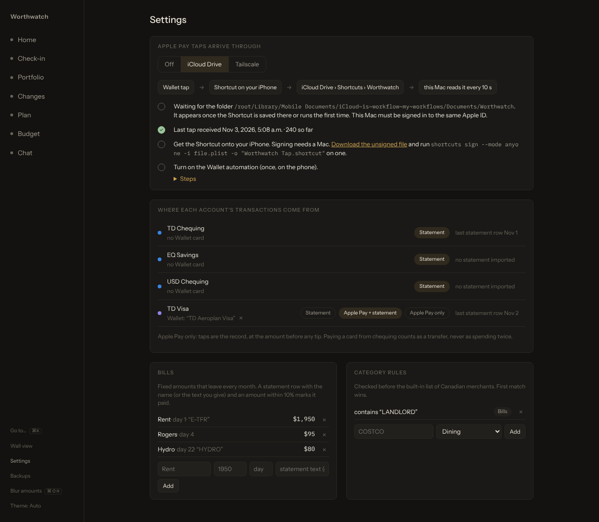

# Set up the Apple Pay feed

This page shows you how to send each Apple Pay purchase from your iPhone to Worthwatch as you pay, so your budget is current before your bank's statement arrives. You set it up once: a Shortcut that Worthwatch makes for you, and a Wallet automation that runs it.

<picture>
  <source media="(prefers-color-scheme: light)" srcset="screenshots/settings-light.png">
  
</picture>

## How it works

When you pay with a Wallet card, iOS runs a Shortcuts automation. The automation hands the merchant, amount and card to the **Worthwatch Tap** Shortcut, which delivers it to your Mac one of two ways:

```text
                    ┌─ iCloud Drive ─▶ Shortcuts/Worthwatch/taps-2026-11.jsonl ─▶ Mac reads it every 10 s ─┐
 tap ─▶ automation ─┤                                                                                     ├─▶ Budget
                    └─ Tailscale ────▶ POST /api/ingest/transaction (with your token) ────────────────────┘
```

| Delivery | Setup on the Mac | Delay | When the Mac is off |
|---|---|---|---|
| **iCloud Drive** (default) | None. The Mac signs in to the same Apple ID. | Usually under a minute, as fast as iCloud syncs. | Taps wait in iCloud and arrive when it's back. |
| **Tailscale** | Tailscale on the Mac and the iPhone, plus one `tailscale serve` command. | A few seconds. | The Shortcut keeps a queue and sends it with your next tap. |

Each tap shows on **Budget** as *not on a statement yet*. When you [import the statement](budgeting.md#import-a-statement), Worthwatch matches the row to the tap, so it's counted once. A tipped restaurant bill matches its higher posted amount.

Your purchases go from your phone to your Mac, through your own iCloud account or your own tailnet. No bank login is involved, and nothing goes to a Worthwatch server.

## Before you begin

- Worthwatch runs on a Mac that stays on. See [Run Worthwatch on a Mac](macos.md).
- Your iPhone runs iOS 17 or later, with the cards you use in Wallet.
- For iCloud Drive: the Mac and the iPhone are signed in to the same Apple ID, with iCloud Drive turned on.
- For Tailscale: Tailscale is installed and signed in on both. See [Access Worthwatch remotely](remote-access.md#use-tailscale).

## Choose how taps reach your Mac

1. In Worthwatch, open **Settings**. You can also select **Settings** at the bottom of the side bar.
2. Under **Apple Pay taps arrive through**, choose **iCloud Drive** or **Tailscale**.

### Use iCloud Drive

1. Make sure iCloud keeps the Shortcuts folder on the Mac. In Finder, open **iCloud Drive**, Control-click the **Shortcuts** folder, and choose **Keep Downloaded**.
2. In **Settings**, wait for **Folder found** to show a check mark. The folder appears after the Shortcut is saved there in the next section.

### Use Tailscale

1. On the Mac, share only the feed's address with your tailnet:

   ```sh
   tailscale serve --bg --set-path /api/ingest http://127.0.0.1:7777/api/ingest
   ```

   If you already share the whole app with `tailscale serve --bg 7777`, skip this step.
2. In **Settings**, check **This Mac's Tailscale address**. Worthwatch fills it in when it can ask Tailscale. Otherwise, enter the `https://….ts.net` address that `tailscale serve status` prints, and select **Save**.

Every request needs the token shown beside **Token**. A request without it gets `401 Unauthorized` and saves nothing.

## Add the Shortcut to your iPhone

1. In **Settings**, select **Make Shortcut**. Worthwatch signs the Shortcut and saves it to **iCloud Drive › Shortcuts › Worthwatch › Worthwatch Tap.shortcut**.
2. On your iPhone, open **Files** › **iCloud Drive** › **Shortcuts** › **Worthwatch**.
3. Tap **Worthwatch Tap**, then tap **Add Shortcut**.

In Tailscale mode the Shortcut contains your Mac's address and token. When you change either, select **Make again** and add the new Shortcut on the phone, replacing the old one.

> [!NOTE]
> Signing needs the `shortcuts` command, which only macOS has. If Worthwatch runs elsewhere, select **Download the unsigned file**, then sign it on any Mac:
>
> ```sh
> shortcuts sign --mode anyone -i worthwatch-tap.plist -o "Worthwatch Tap.shortcut"
> ```
>
> AirDrop the signed file to your phone, or [build the Shortcut by hand](#build-the-shortcut-by-hand).

## Turn on the Wallet automation

iOS doesn't let an app create this automation for you, so you add it once on the phone.

1. Open **Shortcuts** and tap **Automation**, then **+** (or **New Automation**).
2. Tap **Transaction**.
3. Under **Card**, select the Wallet cards you want to follow. Leave **Category** and **Merchant** set to **Any**.
4. Select **Run Immediately**, turn off **Notify When Run**, and tap **Next**.
5. Tap **New Blank Automation**.
6. Add a **Dictionary** action. Add four **Text** items. For each value, tap the field and pick the variable from the **Shortcut Input** menu:

   | Key | Value |
   |---|---|
   | `merchant` | Merchant |
   | `amount` | Amount |
   | `card` | Card or Pass |
   | `name` | Name |

7. Add a **Run Shortcut** action, choose **Worthwatch Tap**, and set its input to **Dictionary**.
8. Tap **Done**.

Make a small purchase to test it. In iCloud mode the tap shows on **Budget** within about a minute; in Tailscale mode, within a few seconds. **Settings** shows **Last tap received** and a count.

## Get notified on your iPhone

Once you've [set a budget](budgeting.md#set-a-budget-for-each-category), the **Worthwatch Tap** Shortcut shows a notification after each tap with what's left of today's allowance in the [budget game](budget-game.md). You don't need to change anything for this. If you added the Shortcut before notifications existed, select **Make again** and add it on the phone again, replacing the old one.

| Delivery | What the notification shows |
|---|---|
| **Tailscale** | The total after this tap. The Mac works it out and sends it back in its reply. |
| **iCloud Drive** | The total *before* this tap. The phone can't wait for the Mac, so it reads `Worthwatch/game/today.json`, which the Mac rewrites within seconds of each change. |

```text
 Tailscale:  tap ─▶ POST /api/ingest/transaction ─▶ reply.notify ─────────────▶ Show Notification
 iCloud:     tap ─▶ append taps-YYYY-MM.jsonl
                    read game/today.json (written by the Mac) ─▶ "tap" line ─▶ Show Notification
```

### Add the morning recap

A second Shortcut, **Worthwatch Day**, tells you each morning how yesterday closed and what you have today.

1. In **Settings**, select **Make Shortcut**. Worthwatch saves **Worthwatch Day** beside **Worthwatch Tap**.
2. On your iPhone, open **Files** › **iCloud Drive** › **Shortcuts** › **Worthwatch**, tap **Worthwatch Day**, then tap **Add Shortcut**.
3. In **Shortcuts**, tap **Automation**, then **+**.
4. Tap **Time of Day**, set it to **8:00 AM**, **Daily**, and select **Run Immediately**. Tap **Next**.
5. Tap **New Blank Automation**, add a **Run Shortcut** action, and choose **Worthwatch Day**. Tap **Done**.

In Tailscale mode the Shortcut asks `GET /api/ingest/day` with your token. In iCloud mode it reads the `day` line from `Worthwatch/game/today.json`.

> [!NOTE]
> Notifications from a Shortcut carry the Shortcuts icon, not a Worthwatch icon, and they're plain text. iOS doesn't let a Shortcut change either.

## Link each Wallet card to an account

The first tap from a new card shows as a chip at the top of **Budget**, for example *Amex Cobalt tapped 2 times. Which account is it?* Choose the credit card account it belongs to and select **Link**. Worthwatch moves its taps there and sets the account's source to **Apple Pay + CSV**.

You can only link a card to a credit card account. Paying the card's bill from chequing is a transfer, not spending, because the purchases already count on the card.

To unlink a card, open **Settings** › **Where each account's transactions come from** and select **×** beside the card's name.

## Change the token

The token protects the Tailscale feed. Change it if you think someone has seen it.

1. In **Settings**, beside **Token**, select **New token**. The old token stops working right away.
2. Select **Make again** and add the new Shortcut on your iPhone.

Worthwatch keeps the token in `ingest-token` in your data folder, readable only by you. iCloud mode doesn't use it.

## Build the Shortcut by hand

If you can't sign the generated Shortcut, build it in the Shortcuts app. Name it **Worthwatch Tap**. It only runs from the automation, so it needs no other settings.

**Both modes start with these four actions:**

1. **Format Date**: Current Date, Custom format `yyyy-MM-dd'T'HH:mm:ss.SSSZZZZZ`.
2. **Format Date**: Current Date, Custom format `yyyy-MM`.
3. **Get Dictionary from** Shortcut Input.
4. **Set Dictionary Value**: key `at`, value the first Formatted Date, in Dictionary.

**For iCloud Drive, add these:**

5. **Append to Text File**: append the Dictionary to `Worthwatch/taps-` + the second Formatted Date + `.jsonl`, with **Make New Line** on.
6. **Get File** `Worthwatch/game/today.json`, with **Error If Not Found** off.
7. **Get Dictionary from** the File.
8. **Get Dictionary Value** for key `tap` in the Dictionary.
9. **If** Dictionary Value **has any value**: **Show Notification** with the Dictionary Value as the body, then **End If**.

**For Tailscale, add these instead:**

5. **Append to Text File**: append the Dictionary to `Worthwatch/queue.jsonl`, with **Make New Line** on.
6. **Get File** `Worthwatch/queue.jsonl`, with **Error If Not Found** off.
7. **Get Contents of URL**: `https://<your-mac>.ts.net/api/ingest/transaction`, method **POST**, header `Authorization` = `Bearer <your token>`, request body **File** = the File from step 6.
8. **If** Contents of URL **contains** `worthwatch_saved`:
9. &nbsp;&nbsp;&nbsp;**Delete** the File from step 6, with **Confirm Before Deleting** off.
10. **End If**.
11. **Get Dictionary Value** for key `notify` in Contents of URL.
12. **If** Dictionary Value **has any value**: **Show Notification** with the Dictionary Value as the body, then **End If**.

The queue is why an offline tap isn't lost: iOS never retries a failed Shortcut, so the tap is written to the queue first and deleted only after your Mac confirms it saved it. Sending a tap twice is safe, because Worthwatch ignores taps it already has.

## Send taps from something else

The feed is a plain HTTP endpoint, so any tool on your tailnet can post to it:

```sh
curl -H "Authorization: Bearer $(cat data/ingest-token)" \
  --data '{"merchant":"Loblaws","amount":"62.18","card":"TD Aeroplan Visa","at":"2026-11-03T12:30:00-05:00"}' \
  http://127.0.0.1:7777/api/ingest/transaction
```

The body is one JSON object, an array of them, or one object per line. `merchant`, `amount` and `card` are required; `at`, `name` and `currency` are optional. The reply contains `worthwatch_saved` with the number of taps added and the number already there, and `notify`, the notification line for the [budget game](budget-game.md). `notify` is empty until you set a budget. When the feed is set to **Off**, the endpoint answers `409` and saves nothing.

## Troubleshoot the feed

| Symptom | What to do |
|---|---|
| **Settings** says *Waiting for the folder*. | Check that the Mac uses the same Apple ID as the phone and has iCloud Drive on. Make the Shortcut once, or make one tap; the folder appears after the first file. |
| **Settings** lists files *not downloaded to this Mac*. | Control-click **iCloud Drive › Shortcuts** in Finder and choose **Keep Downloaded**. |
| **Settings** says *macOS blocked reading this folder*. | Open **System Settings › Privacy & Security › Full Disk Access**, select **+**, and add `~/.local/bin/worthwatch`. Press <kbd>⌘⇧G</kbd> in the file dialog to type the path. |
| The automation runs but nothing arrives (Tailscale). | Open the Tailscale app on the phone and check it's connected. Open `https://<your-mac>.ts.net/api/ingest/transaction` in Safari: `405 Method Not Allowed` means the path is shared; a timeout means it isn't. |
| Taps arrive as `401`. | The token changed. Select **Make again** and add the new Shortcut on the phone. |
| A purchase never showed up. | Online and in-app Apple Pay purchases may not run the Wallet automation. The statement import still brings them in. |
| A tap sits in **Review**. | See [Review unmatched taps](budgeting.md#review-unmatched-taps). |
| No notification after a tap. | Set a budget first: the notification needs a daily allowance. Then select **Make again** and add the new Shortcut, since older ones don't show notifications. In iCloud mode, check that `Worthwatch/game/today.json` exists. |
