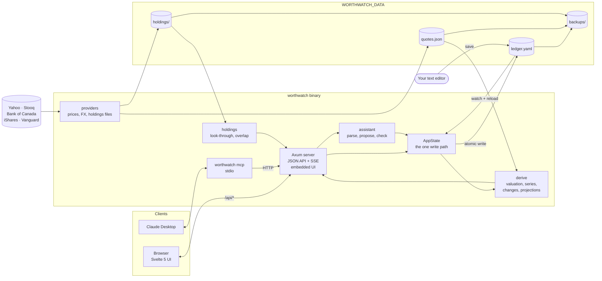

# Architecture

Worthwatch is one Rust binary that serves a Svelte web app and a JSON API. All your data lives in one folder of plain files. This page gives you the big picture. For each feature's detailed data flow, see [Data flows by stage](data-flows.md).

## Overview

Read it left to right. The browser and Claude Desktop only talk to the API. The API reads through `derive` and writes through `AppState`. Providers are the only part that touches the network, and they only write `quotes.json` and `holdings/`.

## Design rules

These rules hold everywhere in the code. When you change something, keep them true.

- **One write path.** Every change is a `ledger::Mutation`. `Ledger::apply` returns a new ledger, and `AppState::apply_many` is the only code that writes `ledger.yaml`. It writes atomically with a temp file and a rename.
- **The file is the truth.** The server watches `ledger.yaml` and reloads it when it changes. If a hand edit breaks the file, the server keeps the last good version, reports the problem with its line number, and refuses to write until you fix it.
- **The core is pure.** `ledger`, `derive` and `holdings` do no IO and never read the clock. Dates come in as arguments, so tests are plain function calls.
- **Exact numbers.** Money is `rust_decimal::Decimal` and dates are `chrono::NaiveDate`. Floats appear only in chart payloads.
- **The server computes; the UI renders.** Each screen gets one view assembled on the server. The UI doesn't recompute totals.
- **Never silently zero.** A missing price or rate is flagged and shown on screen, never counted as zero.
- **Models propose, people approve.** Chat and MCP produce a checked plan. Only the Approve button sends it to the write path.

## Crates

| Crate | What it owns | Depends on |
|---|---|---|
| `crates/ledger` | Schema, YAML IO, validation, `Mutation` and `apply`. | nothing in the workspace |
| `crates/derive` | Valuation, net worth series, portfolio, changes, projections, contribution room. | `ledger` |
| `crates/holdings` | Holdings file parsing, sector and region names, look-through, overlap, drift. | nothing in the workspace |
| `crates/providers` | Yahoo, Stooq, Bank of Canada and issuer fetchers behind traits; `quotes.json`; the holdings store. | `holdings` |
| `crates/importers` | Pasted broker holdings into mutations. | `ledger` |
| `crates/assistant` | Shorthand parser, the `Llm` trait (Ollama, Anthropic), and `resolve`, which checks a proposal against the ledger. | `ledger` |
| `server` | The `worthwatch` binary: Axum routes, file watcher, daily tasks, backups, MCP, embedded UI. | all of the above |
| `ui` | Svelte 5 and Vite. State lives in stores under `ui/src/lib/stores`; screens are thin. | the HTTP API |

## Data folder

| Path | Written by | Notes |
|---|---|---|
| `ledger.yaml` | You, and approved changes | Everything you entered. Safe to edit by hand. |
| `quotes.json` | Price and FX providers | Fetched data only. Safe to delete. |
| `holdings/<SYM>/<date>.json` | Holdings store | One file per fund per disclosure date. Never rewritten. |
| `holdings/<SYM>.csv` | You | Drop-in holdings file, read on load. |
| `backups/` | Daily task, Backups screen, `worthwatch backup` | Newest 30 kept. |

## Commands

| Command | What it does |
|---|---|
| `worthwatch` | Runs the server. |
| `worthwatch seed [--force]` | Writes a 14-month sample ledger, quotes and fund holdings. |
| `worthwatch mcp` | Runs the MCP server on stdio. See [Connect Claude Desktop](mcp.md). |
| `worthwatch backup` | Writes a backup. |
| `worthwatch restore <file> [--force]` | Restores a backup. See [Back up and restore](backup-restore.md). |

## Learn more

- [Data flows by stage](data-flows.md#server-routes) lists every API route.
- [Data flows by stage](data-flows.md#ui) describes UI routes, stores and charts.
