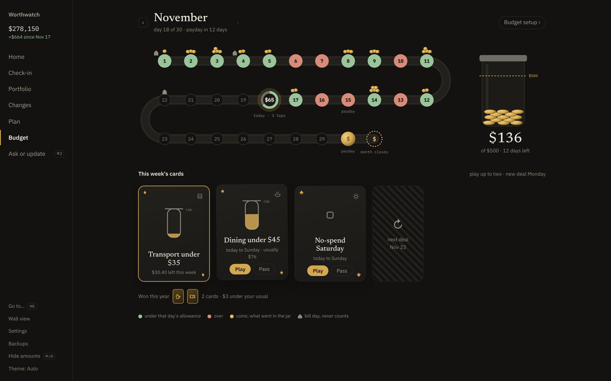
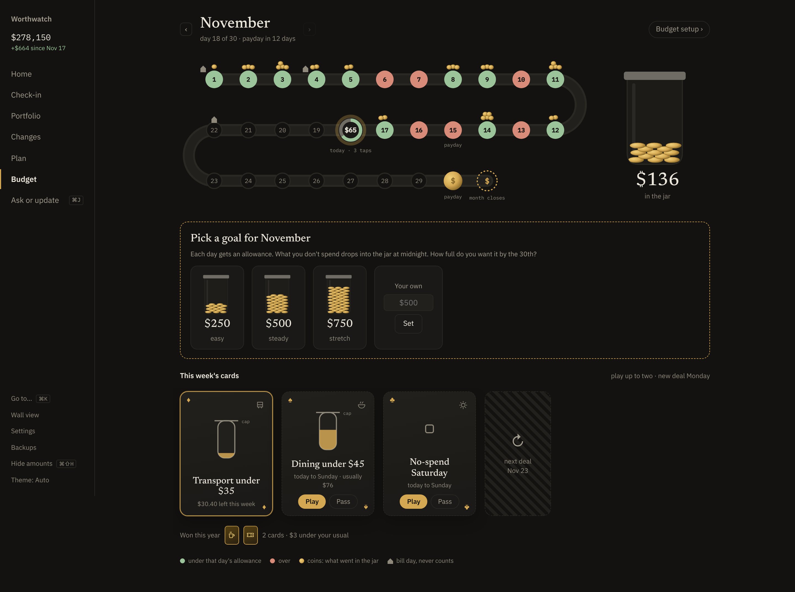
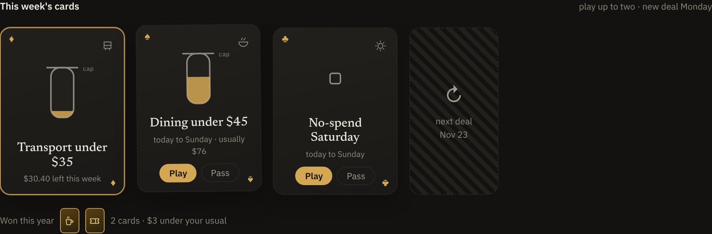
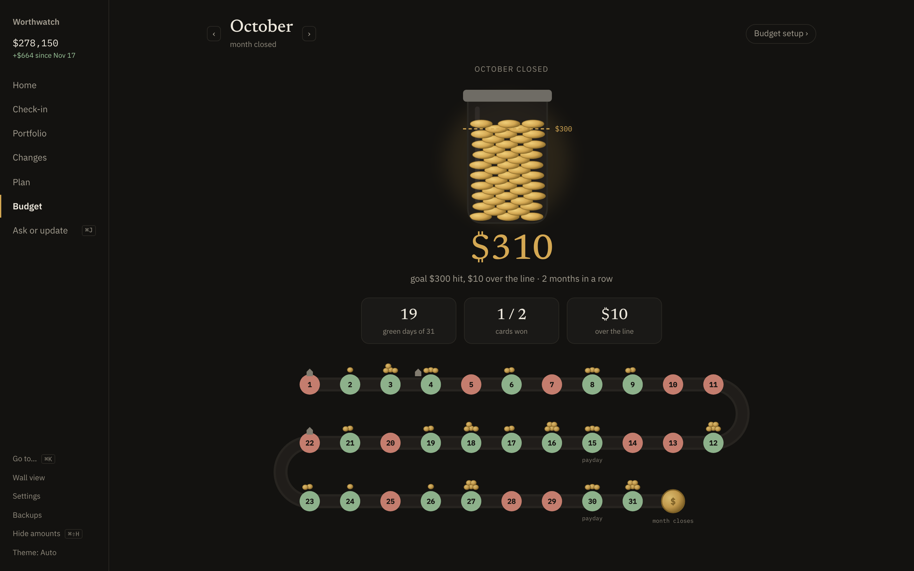
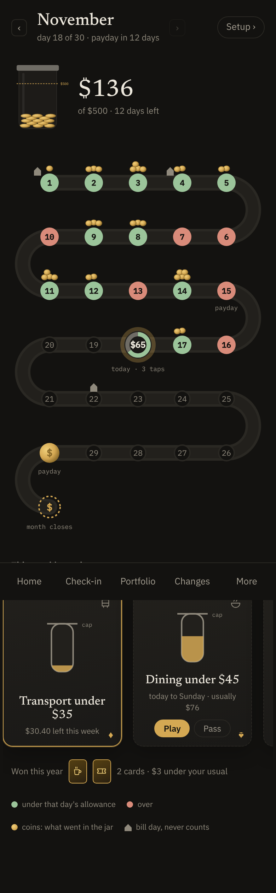

# Play the budget game

This page explains the budget game: a daily allowance you try to beat, a jar that fills with what you don't spend, and weekly challenge cards. The game sits beside the **Budget** screen. You set up categories and limits on **Budget**, and you play on **Budget › Play**.

<picture>
  <source media="(prefers-color-scheme: light)" srcset="screenshots/play-light.png">
  
</picture>

## How it works

You have one goal: fill the jar to your monthly goal by the end of the month.

1. **Each day gets an allowance.** Worthwatch takes your monthly budget, leaves out bills, and splits the rest across the days. Days you usually spend more on, such as Saturdays, get a bigger share.
2. **Each tap drains today.** Your token on the track shows what's left of today's allowance. Your iPhone tells you after each Apple Pay tap.
3. **At midnight the day closes.** What you didn't spend drops into the jar as coins, and the day turns green. If you went over, the difference comes out of the jar, and the day turns red.
4. **At the end of the month, the jar is scored against your goal.** Hit it three months in a row and Worthwatch offers a higher goal. Miss it twice in a row and it offers a lower one.

Cards are optional side quests. Each Monday Worthwatch deals up to three, such as **Coffee under $25** or **No-spend Saturday**, based on your last eight weeks. You can play up to two a week.

```text
 Budget limits ──▶ monthly allowance ──▶ daily allowance (weighted by weekday)
   (minus bills)                              │
                                              ▼
 Apple Pay tap ──▶ today's token drains ──▶ midnight: allowance − spent
       │                                      │
       ▼                                      ├─ ≥ 0 ─▶ coins into the jar, day turns green
 iPhone notification                          └─ < 0 ─▶ out of the jar, day turns red
 "Presto · $4.60: $7 left today"              │
                                              end of month ─▶ jar vs. goal ─▶ hit / miss, streak
```

The game reads the same transactions as **Budget**. Your bank statement still has the last word: when a statement row corrects a tap's amount, the day's result changes with it.

## Before you begin

- Set a budget for at least one category on **Budget**. See [Set a budget for each category](budgeting.md#set-a-budget-for-each-category). Without a budget, **Play** asks you to set one.
- For notifications on your iPhone, set up the [Apple Pay feed](apple-pay-feed.md).

## Open the game

- On **Budget**, select **Play** beside the month.
- Or press <kbd>⌘</kbd> <kbd>K</kbd> and choose **Budget › Play**.

To go back to setting up categories and limits, select **Budget setup** at the top right.

## Pick a goal for the month

The first time you open the game, Worthwatch offers three goals: **easy**, **steady** and **stretch**. They're 10%, 20% and 30% of the month's allowance, rounded to $50.

1. Select one of the three jars, or enter your own amount under **Your own** and select **Set**.
2. The jar shows the goal as a dashed line. Coins fill the jar as days close.

<picture>
  <source media="(prefers-color-scheme: light)" srcset="screenshots/play-pick-goal-light.png">
  
</picture>

The goal carries over from month to month until you change it.

## Read the track

The track has one stop per day of the month.

| On the track | What it means |
|---|---|
| Green stop with coins | You spent less than that day's allowance. More coins means more of the allowance was left, up to five. |
| Red stop | You spent more than that day's allowance. The difference came out of the jar. |
| Ring with an amount | Today. The green arc is what's left of today's allowance. |
| House | A bill is due that day. Bills never count against the day. |
| Gold coin | Your next payday, found from your income over the last two months. |
| Dashed `$` at the end | The month closes there. |

Hover over a stop to see what you spent that day and what went into or out of the jar.

### How the daily allowance is set

The daily allowance isn't your monthly budget divided by the number of days. Worthwatch looks at what you spent on each weekday over the last three months and gives heavier days a bigger share. A day never gets less than half or more than twice an average day. With less than four weeks of history, every day gets the same share.

Bills, income and transfers between your own accounts never count. Only everyday spending drains the token.

## Play a card

Each card shows its progress as a picture: a cup or tube that fills toward its cap, or a row of squares that tick off clean days.

1. Under **This week's cards**, select **Play** on a card you want, or **Pass** to hide it.
2. Keep spending in that category under the cap, or at zero on the named days, until Sunday.

<picture>
  <source media="(prefers-color-scheme: light)" srcset="screenshots/play-cards-light.png">
  
</picture>

A card dealt mid-week covers today to Sunday, with its cap cut to the days left. Won cards go on the **Won this year** shelf with how much you kept compared to your usual week.

Cards don't change the jar on their own. They're a way to aim at the categories that usually push your days red.

## Close the month

On the 1st, the previous month closes. Open it with the **‹** arrow to see the result: the final jar, whether you hit the goal, your green days, and the cards you won.

<picture>
  <source media="(prefers-color-scheme: light)" srcset="screenshots/play-closed-light.png">
  
</picture>

If Worthwatch suggests a new goal, select **Raise the goal** or **Lower the goal** to accept it, or **Keep** to stay where you are. A raise is 5% higher, rounded up to $10. A lower goal is 5% less, rounded down to $10.

## Get notifications on your iPhone

With the [Apple Pay feed](apple-pay-feed.md) set up, your iPhone shows a notification after each tap. The last part appears only when the tap touches a card you're playing:

```text
Presto · $4.60
$7 left today
Jar $22 of $600 · Coffee under $25: $6.25 left
```

You can also get a morning recap at 8:00 AM:

```text
Worthwatch
Tuesday closed: $35 into the jar
Jar $136 of $500 · today: $64
```

To set them up, see [Get notified on your iPhone](apple-pay-feed.md#get-notified-on-your-iphone).

## Use the game on a phone

**Play** works in Safari on your iPhone over [Tailscale](remote-access.md#use-tailscale). The track turns into five stops a row, and the cards scroll sideways.



## Edit the game by hand

The goal and your cards are saved under `budget.game` in `ledger.yaml`:

```yaml
budget:
  game:
    goal: 500
    cards:
      - id: 2026-11-19-cap-transport
        week: 2026-11-16             # the Monday of the card's week
        from: 2026-11-19             # optional: dealt mid-week
        rule: { kind: cap, category: transport, amount: 35 }
      - id: 2026-11-09-nospend-5
        week: 2026-11-09
        rule: { kind: no_spend, category: null, weekdays: [5] }   # 0 is Monday
    passed: [2026-11-16-cap-coffee]
```

Worthwatch checks each card when it loads the file. A card's `week` must be a Monday, and at most two cards can share a week.

## What's next

- [Budget your spending](budgeting.md): set limits, import statements and sort categories.
- [Set up the Apple Pay feed](apple-pay-feed.md) so taps and notifications arrive as you pay.
