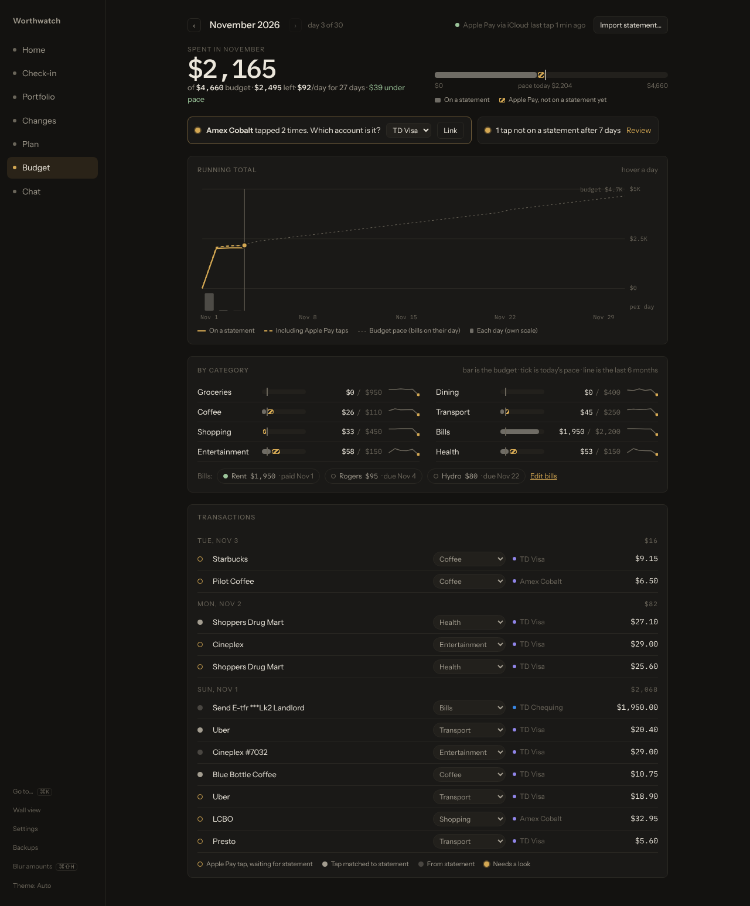
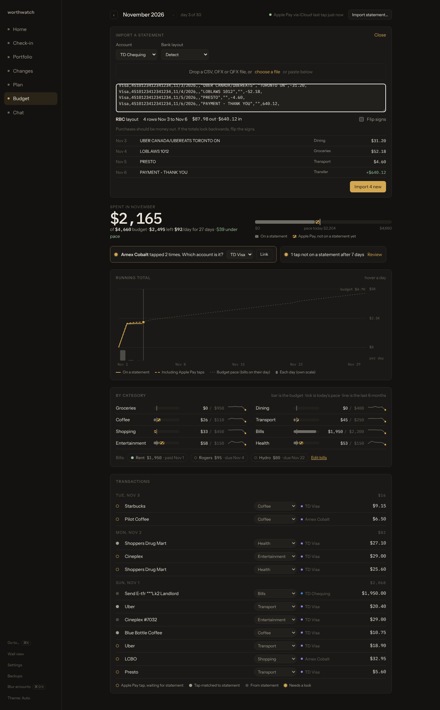
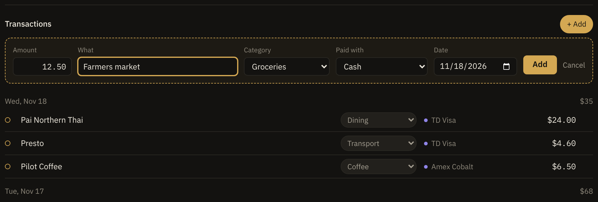
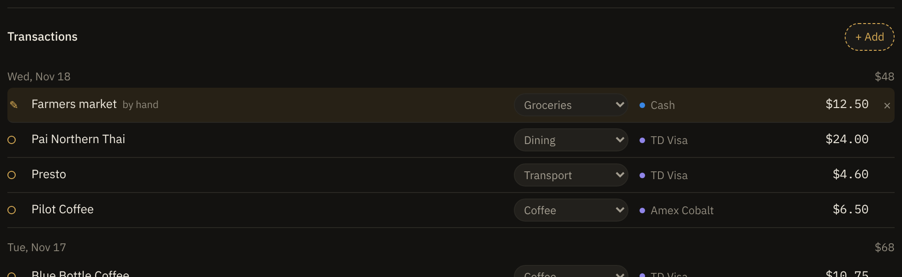
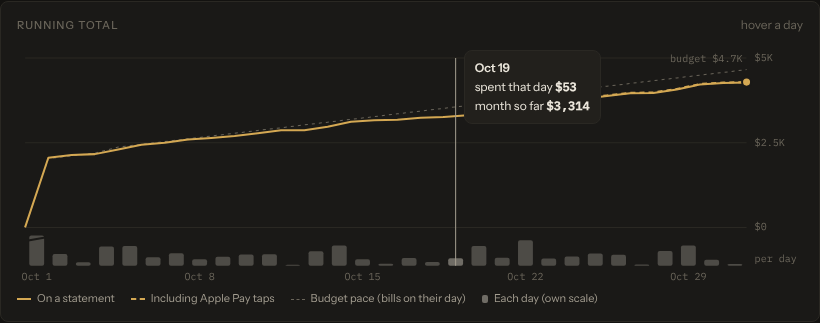

# Budget your spending

This page shows you how to set a monthly budget, bring in your bank and card transactions, and keep them sorted into categories. To have Apple Pay purchases show up the moment you tap, also set up the [Apple Pay feed](apple-pay-feed.md).

<picture>
  <source media="(prefers-color-scheme: light)" srcset="screenshots/budget-light.png">
  
</picture>

## How it works

Worthwatch builds each month from three kinds of records:

- **Statement rows** that you import from your bank's CSV or OFX export. These are the final word on what you spent.
- **Apple Pay taps** that your iPhone sends as you pay. These show up right away and are marked *not on a statement yet* until the matching row arrives.
- **Entries you add by hand**, such as cash, or a card you don't tap with. See [Add a purchase by hand](#add-a-purchase-by-hand).

```text
 iPhone tap ──────────────▶ provisional ──┐
 added by hand, on a card ▶ provisional ──┼─▶ reconcile ─▶ confirmed (one transaction, not two)
 bank CSV row ────────────▶ posted ───────┘
 added by hand, cash ─────▶ counts as entered (no statement to wait for)
```

When you import a statement, Worthwatch pairs each tap with its row, so a purchase is never counted twice. You don't need to tap to use the budget: statements alone work fine.

## Before you begin

- Add the accounts you spend from (chequing and credit cards) on the **Check-in** screen if they aren't there yet.
- Download a recent statement from your bank as CSV or OFX. See [Export a statement from your bank](#export-a-statement-from-your-bank).

## Import a statement

1. Open **Budget** and select **Import statement…**. You can also press <kbd>⌘K</kbd> and type *import*.
2. Choose the **Account** the statement belongs to.
3. Drag the file onto the panel, select **choose a file**, or paste the text.
4. Check the preview. Worthwatch detects the bank layout, shows the date range and the money in and out, and dims rows you already imported.
5. If purchases show as money *in*, turn on **Flip signs**.
6. Select **Import N new**.



Nothing is written before you select Import. Importing the same file again adds nothing, so overlapping date ranges are safe.

### Export a statement from your bank

Most Canadian banks export from the account's activity page. The menu names change often, so look for **Download**, **Export** or **Download transactions**.

| Bank | Format to pick | Layout name in Worthwatch |
|---|---|---|
| TD | Spreadsheet (.csv) | TD (no header row) |
| RBC | Comma-separated values (.csv) | RBC |
| CIBC | Spreadsheet (.csv) | CIBC (no header row) |
| Scotiabank | CSV | Scotiabank |
| BMO | CSV or Microsoft Money (.ofx) | BMO |
| Tangerine | CSV or OFX | Tangerine |
| American Express | CSV | Amex |
| Simplii | CSV | Simplii |
| EQ Bank | CSV | EQ Bank |
| Any other | OFX, QFX, or a CSV with a header row | Detect |

> [!TIP]
> When your bank offers both, pick OFX or QFX. Each OFX row carries a bank ID, so re-imports match exactly even when a description changes.

## Add a purchase by hand

Use this for anything that doesn't come from Apple Pay or a statement, such as cash at a farmers market, or a card you don't import.

1. On **Budget**, select **+ Add** beside **Transactions**.
2. Enter the **Amount** and **What** it was.
3. Optional: choose a **Category**. If you leave it on **Pick for me**, your category rules choose one.
4. Choose what you **Paid with**: **Cash**, or one of your bank accounts or cards.
5. Optional: change the **Date**. It starts on today. On a past month, it starts on that month's last day.
6. Select **Add**.

<picture>
  <source media="(prefers-color-scheme: light)" srcset="screenshots/budget-add-form-light.png">
  
</picture>

The entry shows at once with a pencil mark ✎ and counts toward the month, the category bars and the [budget game](budget-game.md). To take it back, select **×** at the end of its row, or **Undo** in the confirmation line.

<picture>
  <source media="(prefers-color-scheme: light)" srcset="screenshots/budget-added-light.png">
  
</picture>

What happens next depends on what you paid with:

- **Cash** counts as you entered it. It never goes to **Review**, because there's no statement to wait for.
- **A bank account or card** waits for its statement row like a tap does. When you import the statement, the row replaces your entry's amount and date, so the purchase is counted once. If you don't import statements for that account, your entry is the record.

You can also add purchases from **Chat**, such as `coffee 6 cash` or `lunch 18.40 on td visa`, and from the [budget game](budget-game.md#add-a-cash-spend). Chat shows a card first, and nothing is saved until you approve it.

## Set a budget for each category

1. On **Budget**, find the category under **Categories**.
2. Select its limit, type the new amount, and press <kbd>Enter</kbd>. Clear the field to remove the limit.

Each bar shows what you spent, a hatched part for taps that aren't on a statement yet, and a tick where your pace says you should be today. The line beside it shows the last six months.

The month's total budget is the sum of your category limits. The running-total chart compares your spending with that budget day by day. Bills count on their due day, and the rest of the budget is spread evenly, so paying rent on the 1st doesn't put you "over pace".



## Fix a transaction's category

Worthwatch picks a category for each transaction in this order:

1. Your own rules.
2. A built-in list of Canadian merchants, such as Loblaws, Presto and Tim Hortons.
3. The sign: money in on chequing is income, everything else is *Other*.

To change one transaction, choose a new category from the menu on its row. Worthwatch then offers to **make it a rule**, so future transactions with the same words go there too.

To edit rules, open **Settings** › **Category rules**. A rule matches when the transaction's description contains the words you type, ignoring case. To limit a rule to one account, add `account: <account id>` to it in `ledger.yaml`.

*Transfer* and *Income* never count as spending. Paying your credit card bill from chequing is a transfer, because the purchases already count on the card.

## Track your bills

Bills are the payments you expect every month, such as rent, your phone and hydro.

1. Open **Settings** › **Bills**.
2. Enter a name, the amount, and the day of the month it's due.
3. Optional: in **statement text**, enter text from the statement description, such as `E-TFR` for rent sent by Interac e-Transfer. Without it, Worthwatch matches on the bill's name.
4. Select **Add**.

On **Budget**, each bill shows as paid, with the date, once a statement row matches its text and comes within 10% of its amount. Unpaid bills show their due day.

## Review unmatched taps

A tap that is still unmatched seven days later moves to **Review**. This usually means one of these:

- The purchase was declined or refunded at the counter.
- The card isn't one you import statements for. Set that account to **Apple Pay only** in **Settings** › **Where each account's transactions come from**.
- The statement row is missing from your export. Import a newer statement.

A tap from a Wallet card you haven't linked shows as a chip at the top of **Budget**. Choose the account it belongs to, and Worthwatch moves its taps there.

## Choose where each account's transactions come from

Open **Settings** › **Where each account's transactions come from** and pick one source for each account:

| Source | Use it when |
|---|---|
| Bank CSV | You import statements and don't use Apple Pay with this account. This is the default. |
| Apple Pay + CSV | You tap with this card and also import its statements. Taps show right away and are confirmed by the statement. |
| Apple Pay only | Your bank doesn't export, or you don't want to. Each tap is the record. |

The Apple Pay options appear once a Wallet card is linked to the account.

## Edit the budget by hand

All budget settings live under `budget:` in `ledger.yaml`, so you can edit them in a text editor too:

```yaml
budget:
  limits:
    groceries: 950
    dining: 400
  cards:
    TD Aeroplan Visa: td-visa        # Wallet card name → account
  sources:
    td-visa: apple_pay_statement     # statement | apple_pay_statement | apple_pay
  rules:
  - contains: LANDLORD
    category: bills
  bills:
  - name: Rent
    amount: 1950.00
    every: month
    matches: E-TFR
    day: 1
  feed:
    mode: icloud                     # off | icloud | tailscale
```

Transactions themselves live in `transactions/YYYY-MM.jsonl`, one line each. Worthwatch only ever appends to these files. An entry you add by hand is a `manual` line, and removing one appends a `void` line that hides it:

```json
{"source":"manual","id":"man-2026-11-18-6c1f0e2a9b44","date":"2026-11-18","merchant":"Farmers market","amount":"12.50","category":"groceries","added":"2026-11-18T21:30:00Z"}
{"source":"void","id":"void-man-2026-11-18-6c1f0e2a9b44","target":"man-2026-11-18-6c1f0e2a9b44","date":"2026-11-18","at":"2026-11-18T21:31:00Z"}
```

An entry with no `account` is cash. Categories you pick by hand are saved in `transactions/categories.json`. Both are included in [backups](backup-restore.md).

## What's next

- [Play the budget game](budget-game.md): beat a daily allowance and fill a jar to your monthly goal.
- [Set up the Apple Pay feed](apple-pay-feed.md) so taps show up as you pay.
- [Run Worthwatch on a Mac](macos.md) that stays on, such as a Mac mini.
