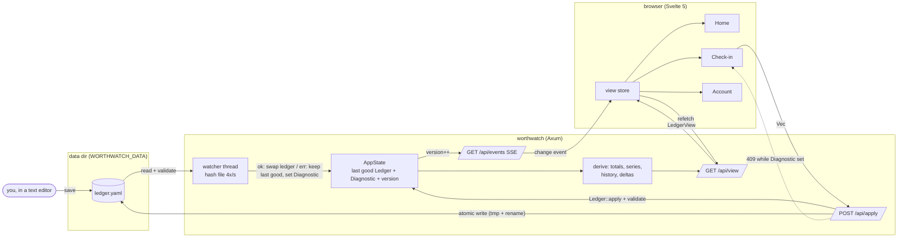
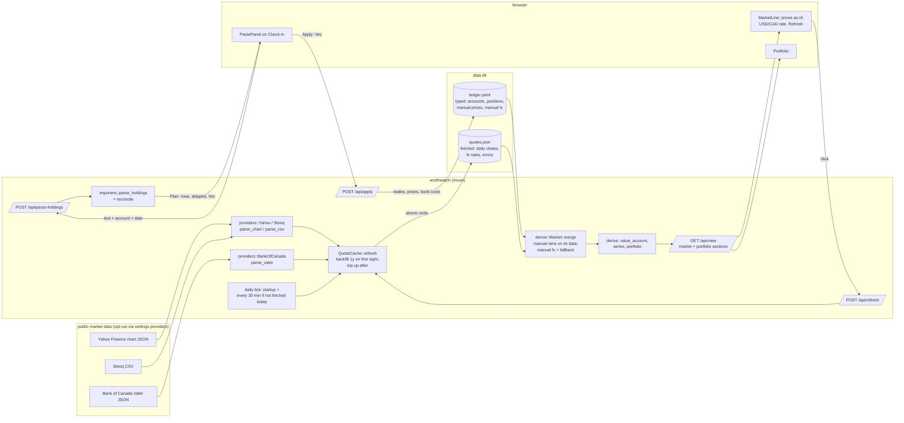
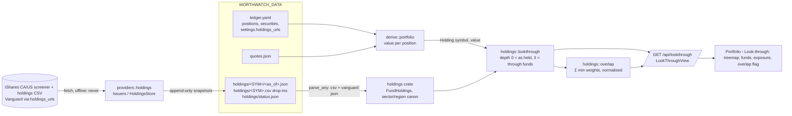
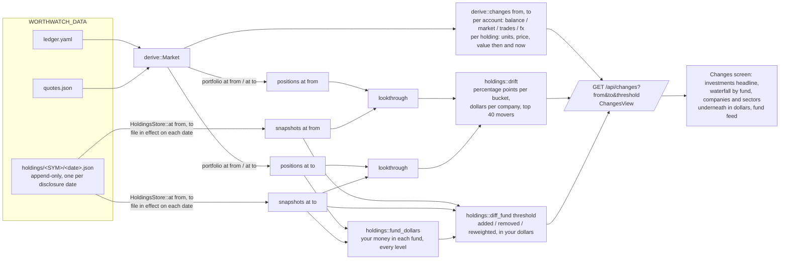
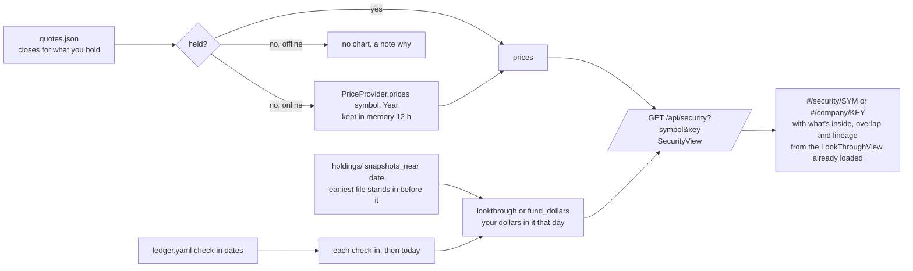
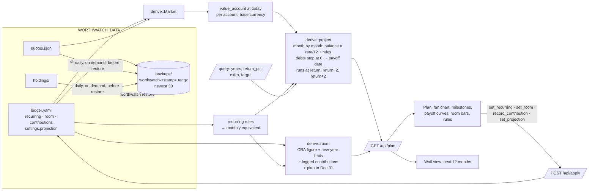
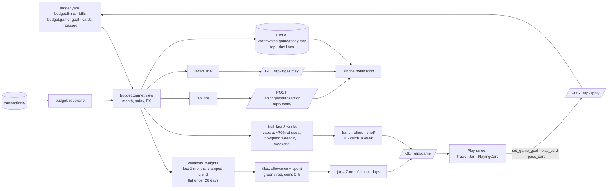

# Data flows by stage

This page is the detailed reference behind [Architecture](architecture.md). It records the rules each stage added and a diagram of each stage's data flow. Start with the architecture overview if you are new to the code.

## Core rules

1. **One write path.** Every change is a `ledger::Mutation` applied by `Ledger::apply`, which returns a new `Ledger`. `server::state::AppState::apply_many` is the only thing that writes `ledger.yaml`, and it writes atomically (temp file + rename).
2. **Core is pure.** `crates/ledger` and `crates/derive` do no IO except `ledger::io`, and never read the clock. Dates come in as arguments.
3. **Exact numbers.** `rust_decimal::Decimal` for money, `chrono::NaiveDate` for dates. No `f64` outside chart payloads.
4. **One view per screen.** `server::routes::LedgerView` is assembled server-side; the UI renders it and never recomputes totals.
5. **The file is the truth, even when broken.** `server::state` polls `ledger.yaml` (mtime + size, 4×/s; polling so Docker bind mounts work) and reloads it. A file that fails to parse or validate leaves the last good `Ledger` in memory, sets a `Diagnostic` (line number when the YAML parser gave one), and makes `apply` refuse with 409 until the file is fixed, so a hand edit is never overwritten. Changes fan out to the UI over `/api/events` (SSE) and the UI re-fetches `/api/view`.
6. **Dependency direction.** `ui -> server -> derive -> ledger`, with `providers`, `holdings`, `importers` and `assistant` as siblings the server glues in (`importers -> ledger`; `assistant -> ledger`; `providers -> holdings`; `holdings` depends on nothing in the workspace). Nothing below `server` knows about HTTP.
7. **Two files, two kinds of data.** `ledger.yaml` holds what you would type: accounts, balances, positions, prices and FX rates you entered. `quotes.json` beside it holds what the app fetched. It is never hand-edited and can be deleted; the next refresh rebuilds it. `derive::Market` merges the two for valuation: a typed price wins over a fetched one for the same date, and a typed FX rate is the fallback when no fetched rate covers the date.
8. **Providers at the boundary only.** `PriceProvider` and `FxProvider` are the only traits; each has a `Manual` (fixed answers) and `Off` impl, and every real provider is a pure `parse_*` function over fixture-tested bytes plus a thin blocking HTTP shim. No test touches the network; `WORTHWATCH_OFFLINE=1` makes the binary never touch it either.
9. **Never silently zero.** A holding with no price, or an account in a currency with no rate, is flagged (`missing_price`, `missing_fx`, `unpriced`) and shown as "no price" / "no FX" in brass. Stale fetched prices keep their date on screen.

## Stage 1 data flow



Reading it: the file is the only store. The UI never writes the file; it sends mutations, the server validates and writes atomically, the watcher sees the new bytes, and every open tab refreshes through the event stream. A hand edit takes the same path from the watcher onward. A broken file parks a `Diagnostic` on the state, which the view carries to the banner and which makes `apply` refuse.

## Stage 2 data flow: prices, FX, pasted holdings



Reading it: fetching only ever writes `quotes.json`; the ledger is still written only by `/api/apply`. A refresh bumps the version so open tabs re-fetch the view. Pasting is two round trips: `/api/parse-holdings` is pure (parse, resolve symbols against the account, diff against current units, propose mutations) and writes nothing; the user sees the preview and `Apply` sends the proposed mutations through the one write path.

## Stage 3 data flow: holdings files, look-through, exposure, overlap



Rules on top of the Stage 2 ones:

- **`holdings` is pure.** Parsing (`parse_any` sniffs iShares/Vanguard CSV headers and Vanguard JSON), sector and region canonicalisation, `lookthrough` and `overlap` take values in and give structs out; no IO, no clock. Fixtures under `crates/holdings/fixtures` are the tests.
- **Snapshots are append-only.** `providers::HoldingsStore` keeps `data/holdings/<SYM>/<as_of>.json`, one per fund per disclosure date, and never rewrites an existing date (disk wins). A file dropped in as `data/holdings/<SYM>.csv|json|txt` is parsed on load (date = the file's mtime when the file has none) and saved as a snapshot, so the feature works with no network at all. `status.json` records the last attempt per symbol.
- **Refresh is a BFS.** `HoldingsStore::refresh` fetches every held fund that is stale (30 days) and then any child that is itself a fund (XEQT → XUS → …) up to depth 3. The daily tick runs it; `POST /api/refresh-holdings` forces it. Offline, both only re-read the folder.
- **Look-through weights, never prices.** A company's dollars are your value in the fund × the disclosed weight, through every level. The undisclosed remainder of a fund (>0.5%) is a leaf of its own, never spread over the others. Overlap normalises each fund's leaf weights by its disclosed coverage so `overlap(A, A) = 100%`.
- **Fetch URLs are at the boundary.** Issuer URL patterns live in `providers::holdings::ishares` and are overridable per symbol under `settings.holdings_urls`; the parser never sees a URL.

## Stage 4 data flow: changes between two dates



Rules on top of the Stage 3 ones:

- **The parts add up.** For a position, `change = market + trades + fx` exactly, with `trades = Δunits × end price × end rate`, `market = start units × Δprice × end rate` and `fx = start units × start price × Δrate`; a balance account splits into `balance` and `fx` the same way. What cannot be split (a holding priced at only one end, a missing rate) lands in `residual`, never in a wrong bucket. The net worth figures at both ends are the series' own values.
- **Sold positions still count.** `derive::symbols_ever` lists an account's current positions plus every symbol in its trade log, so a position sold to zero is valued on the dates it was held (series, portfolio and diff all use it).
- **Two dates, two file sets.** `HoldingsStore::at(symbol, date)` serves the newest snapshot dated on or before `date`, from disk; the look-through runs once per end with the files in effect then. As-held drift classifies both ends with the newest files (as held never expands a fund). The fund feed compares, for every fund reached at `to`, the file in effect at `from` with the one at `to`; funds with the same file at both ends are listed as such, funds with no file old enough as such.
- **Threshold is a query, not a setting.** `threshold` (percentage points, default 0.5) filters the feed; moves under it are counted, not shown. Every list is capped (`FEED_CAP` constituents per fund; the UI folds accounts into the bridge and shows the top holdings), so the screen is one page whatever the portfolio size.
- **The default period is the last check-in.** Without `from`, the server picks the latest ledger snapshot date before `to` (else the first known date). The UI's presets (1M, 3M, YTD, 1Y) are computed in the browser and clamped to `first_date`; custom dates are typed.

## A holding's page: one fund or company



- **Only plain quote symbols reach a provider**: letters, digits and `.-^=`, at most 20. A company's symbol comes from its ticker, with `.TO` for a Canadian listing.
- **What you own over time is through every fund**: a held fund is valued from its units; a fund inside one, or a company, from the look-through on that date. Dates before the first holdings file use that file's weights, and the view says so (`estimated_before`).

## Server routes

| Route | What |
|---|---|
| `GET /api/view` | `LedgerView`: totals, series (with per-group values), deltas, every account with history and holdings, the current `problem` if any |
| `POST /api/apply` | `Vec<Mutation>` → new `LedgerView`; 422 on a validation error, 409 while the file on disk is broken |
| `POST /api/refresh` | fetch prices and FX for every held symbol and used currency now; always answers with the view, per-symbol failures in `market.errors` |
| `POST /api/parse-holdings` | `{ account, date, text }` → parsed rows, skipped lines, untouched positions and the proposed `mutations`; writes nothing |
| `GET /api/lookthrough` | `LookThroughView`: look-through (depth 3, top 300 companies) and as-held (depth 0) breakdowns by sector/region/country/asset class/currency, per-fund status, fund × fund overlap (top 12), snapshot list, per-symbol errors |
| `GET /api/changes?from&to&threshold` | `ChangesView` for one period: net worth, every account and holding then/now with the market / trades / FX split, exposure drift (through funds and as held), and per-fund file diffs above the threshold; `from` defaults to the last check-in before `to`, `to` to today, `threshold` to 0.5 pt; 422 on a backwards range |
| `GET /api/security?symbol&key` | `SecurityView` for one fund or company: about a year of daily closes (cached for what you hold, looked up on request otherwise, never offline), and your dollars in it at each check-in and today, through every fund; 400 on a symbol a provider URL can't carry |
| `POST /api/refresh-holdings` | fetch holdings files for every held fund and the funds inside them now (offline: re-read `data/holdings/`); answers with the `LookThroughView` |
| `GET /api/events` | SSE, one `change` event per ledger version |
| `GET /api/plan?years&return_pct&extra&target` | `PlanView`: the projection (monthly points with a ±2 pt band, milestones, debt payoffs, target date), contribution room per TFSA/RRSP/FHSA, the recurring rules with monthly equivalents, and the ledger's own assumptions; query values override them for this answer only |
| `GET /api/backups` · `POST /api/backups` · `GET /api/backups/{name}` | list (newest first), make one now, download one |
| `POST /api/ingest/transaction` | Apple Pay taps (object, array or JSON lines) with `Authorization: Bearer <ingest-token>`; answers `{worthwatch_saved, added, duplicates, errors}`; 401 without the token, 409 when the feed is off |
| `GET /api/budget?month` | `BudgetView`: the month's spending, pace by day, categories with six-month history, bills, transactions with status, review list, unlinked cards, account sources and feed status |
| `POST /api/budget/import/preview` · `POST /api/budget/import` | `{ account, text, preset, flip }` → the parsed statement with duplicates marked (writes nothing), or the rows appended to `transactions/` |
| `POST /api/budget/category` | `{ id, category }` → one hand-picked category in `categories.json` |
| `POST /api/budget/spend` | `[{ date, merchant, amount, account?, category? }]` → `{ added: [id] }`; all or nothing, 422 with a message on a bad entry. Appends `manual` records to `transactions/` |
| `POST /api/budget/spend/remove` | `{ id }` → appends a `void` record for that entry; 404 if no entry added by hand has that id |
| `GET /api/game?month` | `GameView`: the month as tiles (allowance, spent, net, coins, state), the jar, today's taps, this week's hand and offers, the shelf of won cards, the closed month's score and goal suggestions |
| `GET /api/ingest/day` | The morning recap `{ text }` for the Worthwatch Day Shortcut; same Bearer token as the tap feed |
| `GET /api/settings` · `POST /api/settings/token` · `POST /api/settings/shortcut` · `GET /api/settings/shortcut.plist` | feed status and setup checks; a new ingest token; sign and save the Shortcut to iCloud Drive (macOS); the unsigned Shortcut |
| `worthwatch backup` · `worthwatch restore <file> [--force]` | the same backup from the command line; restore unpacks into `WORTHWATCH_DATA`, refuses to replace a ledger without `--force`, and backs the old one up first |
| `worthwatch seed [--force]` | writes a 14-month sample ledger and a `quotes.json` with daily closes for the same span to `WORTHWATCH_DATA` (no typed prices: what a fetching user's file looks like), plus two dated holdings snapshots per seeded fund under `holdings/` (a month apart, a few sleeves reweighted) so the Changes feed has something to show |

## UI

Hash routes `#/`, `#/check-in`, `#/portfolio[/positions]`, `#/security/<symbol>`, `#/company/<key>`, `#/changes`, `#/chat`, `#/plan`, `#/wall` (full screen, no rail), `#/backups`, `#/budget[/import]`, `#/budget/play[/YYYY-MM]`, `#/settings`, `#/accounts/<id>`. ⌘K / Ctrl+K opens the command palette anywhere (`lib/palette.ts` matches and ranks, tested). Global state is five stores under `ui/src/lib/stores`: `view` (the `LedgerView` plus the SSE subscription), `lookthrough` (the `LookThroughView`, fetched once per ledger version when Portfolio, Changes or a holding's page needs it), `changes` (the `ChangesView` for the chosen period and threshold, refetched when either or the ledger version moves), `route`, `prefs` (blur, theme). Screens under `ui/src/screens` render the view; the only browser-side arithmetic is the live preview on Check-in (`lib/networth/checkin.ts`, unit-tested), and the saved numbers always come back from the server. Charts live in `lib/charts` (uPlot for time series, d3-hierarchy for the look-through treemap, plain SVG for the net worth bridge). The Changes screen encodes before it writes: a stacked strip for the split of a change (`SplitStrip`), a diverging bar per row (`DeltaBar`), a before/after weight bar per constituent (`WeightMove`); the words sit in hover titles. The screen is one window on a desktop: a 2×3 board (headline and bridge, then accounts beside holdings, then exposure drift beside fund changes) whose four panels scroll inside themselves, so the page never grows with the portfolio; under 1100px it stacks and each panel keeps a capped height. `lib/portfolio/changes.ts` (tested) does the period presets and the wording. Colours are CSS tokens in `tokens.css`; components never use colour literals.

Playwright smoke flow: `ui/e2e/smoke.spec.ts` runs the real binary on a temp data dir.

`lib/portfolio/market.ts` (tested) words the freshness line; the paste preview and the portfolio numbers come from the server.


## Stage 5 data flow: chat and MCP propose, you approve

```mermaid
flowchart LR
  subgraph you [you]
    T([type in Chat:<br/>"td chq 5102, visa 640"])
    CD([Claude Desktop<br/>or any MCP client])
  end
  subgraph server [worthwatch]
    CH[/POST /api/chat/]
    CTX[chat::context<br/>accounts, values, rates, summary]
    PR[llm::build_prompt<br/>ids, names, kinds, symbols<br/>never a balance]
    subgraph models [Llm trait]
      SH[shorthand::parse<br/>no model]
      OL[Ollama<br/>local default]
      AN[Anthropic<br/>cloud opt-in]
    end
    RP[parse_reply<br/>JSON -> Proposal or reject]
    RS[assistant::resolve<br/>match names, build Vec of Mutation,<br/>apply to a COPY + validate]
    PQ[pending queue<br/>in memory]
    AP[/POST /api/apply<br/>POST /api/pending/id/approve/]
    W[AppState::apply_many<br/>the one write path]
  end
  MCP[worthwatch mcp<br/>stdio JSON-RPC] -->|GET /api/context, /api/view,<br/>/api/lookthrough| server
  CD <-->|get_net_worth, get_accounts,<br/>get_portfolio, get_exposure,<br/>propose_update, check_proposal| MCP
  MCP -->|POST /api/propose| RS
  T --> CH --> CTX --> PR
  PR -->|cloud: preview first,<br/>send only on consent| AN
  PR --> OL
  CTX --> SH
  OL & AN --> RP --> RS
  SH --> RS
  RS -->|Plan: rows, rejected, mutations| T
  RS --> PQ -->|card with Approve / Discard| T
  T -->|Approve| AP --> W --> Y[(ledger.yaml)]
```

Rules on top of the earlier ones:

- **The model proposes, never writes.** `/api/chat` and `/api/propose` have no path to `apply_many`. The only routes that write are `/api/apply` (the Chat card's Approve sends the plan's mutations there) and `/api/pending/{id}/approve`, both of which re-validate against the ledger as it is at that moment. Tested by construction: the chat and MCP tests assert the file is byte-identical until approval.
- **A plan applies whole or not at all.** `resolve` applies every mutation to a copy; if the list fails, `mutations` is emptied and the card cannot be approved. An item that does not resolve (unknown account, selling what is not held, a balance for a holdings account) is a `Rejected` row with a reason and a hint, never a silent zero.
- **Nothing leaves the machine by default.** The default provider is a local Ollama; when it is not running the shorthand parser answers and the card says so. `cloud` needs `settings.assistant.provider: cloud` and `ANTHROPIC_API_KEY`, and every message first comes back as a preview of the exact prompt (identifiers only) with a Send button. `WORTHWATCH_OFFLINE=1` never asks any model.
- **MCP is a client of the app, not of the file.** `worthwatch mcp` speaks JSON-RPC on stdio and calls the running server's HTTP API, so Claude Desktop reads the same numbers as the dashboard and its proposals queue as cards. Pending proposals live in memory: a restart drops them, the safe direction.

## Stage 6 data flow: plan, room, backups



- **Projections never touch the ledger.** `derive::project` is pure and reads today's values; slider values travel as query parameters and are only written when "Save as my defaults" sends a `set_projection` mutation. The model is deliberately plain (nominal monthly compounding, rules as monthly equivalents, money freed by a paid-off debt is not redirected) so the tests can check it against the annuity and amortization formulas.
- **Rules are plans, contributions are facts.** Recurring rules drive the projection and the "planned to Dec 31" part of a room bar; only logged `contributions` count as used room. CRA's own figure (`room.<kind>.amount` on `as_of`) is the anchor: TFSA adds each later January's limit plus last year's withdrawals, FHSA adds $8,000 a year, RRSP adds nothing and asks for the notice-of-assessment figure.
- **A backup is the whole folder that matters.** `ledger.yaml`, `quotes.json`, `holdings/` and (from Stage 7) `transactions/` in one `.tar.gz`; `backups/` itself is never included. Restore unpacks into a staging folder, checks every entry is a plain relative path under those names and that the ledger loads, and only then swaps the files in. The round-trip test restores a seeded backup onto a clean folder and compares the full `LedgerView` and `LookThroughView` JSON.

## Stage 7 data flow: budget, statements, Apple Pay feed

```mermaid
flowchart LR
  subgraph phone [iPhone]
    W[Wallet tap] --> AU[Transaction automation<br/>Dictionary: merchant, amount, card, name]
    AU --> SC[Worthwatch Tap Shortcut<br/>stamps the time]
  end
  SC -- iCloud mode: append --> IC[(iCloud Drive<br/>Shortcuts/Worthwatch/<br/>taps-YYYY-MM.jsonl)]
  SC -- Tailscale mode: append queue.jsonl, POST it,<br/>delete only on worthwatch_saved --> IN[/POST /api/ingest/transaction<br/>Bearer ingest-token/]
  IC -- poll every 10 s,<br/>size + mtime --> RD[iCloud reader]
  CSV([bank CSV / OFX]) --> IMP[/POST /api/budget/import/<br/>parse_statement: presets,<br/>sign, dates, OFX FITID/]
  HAND([+ Add · + cash spend ·<br/>approved Chat card]) --> SP[/POST /api/budget/spend/<br/>Manual · remove appends Void/]
  SP -- Manual · Void --> ST
  RD & IN -- Tap --> ST[(transactions/YYYY-MM.jsonl<br/>append-only, deduped by id)]
  IMP -- CsvRow --> ST
  ST --> RC[budget::reconcile_all<br/>same account, row 0–5 days after,<br/>equal or tipped ≤30% or FX<br/>cash entries count as entered]
  L[ledger.yaml<br/>budget: limits · cards · sources<br/>rules · bills · feed] --> RC
  CAT[(categories.json)] --> RC
  RC --> MV[budget::month<br/>spent · provisional · pace by day<br/>categories · bills · review]
  MV --> BV[/GET /api/budget/] --> UI[Budget screen]
  UI -- set_budget_limit · link_card ·<br/>set_txn_source · set_category_rules ·<br/>set_bills · set_feed --> A[/POST /api/apply/] --> L
  UI -- one row --> CAT
```



- **Two records, one transaction.** A tap and a statement row are stored as they arrived and never edited. `reconcile` pairs them on every read, greedily by exact amount, then merchant similarity, then nearest date. Importing the same statement again or receiving the same tap again is a no-op, because ids are stable: `csv-` plus a hash of account, date, amount, description and occurrence (or `ofx-` plus the bank's FITID), and `tap-` plus a hash of time, card, amount and merchant.
- **Entries added by hand behave like taps.** A `manual` record on an account you import statements for pairs with its row the same way a tap does, so it's never counted twice. A cash entry has no account and takes `Status::Manual`: it counts at once and never goes to Review. Its own category beats the rules, and a category picked later on the row beats both. Removal appends a `void` record; nothing is rewritten. Chat purchases come from `Item::Spend` in the assistant, land in `Plan.spends` (not `mutations`, so net worth never moves), and are written by `add_spends` when the card is approved, including a card proposed over MCP.
- **Statements win.** A matched pair takes the statement's amount and date, so a tipped meal counts at its posted total. A tap with no row after 7 days moves to Review. An account set to Apple Pay only uses taps as the record.
- **The card bill is a transfer.** Cards link only to credit card accounts. Payments between your own accounts are categorized `transfer`, which, like `income`, never counts as spending.
- **The feed is narrow.** `/api/ingest/transaction` and `/api/ingest/day` are the only routes that accept the token. Both reject a missing or wrong one with 401 and write nothing, and the tap route answers 409 when the feed is off. `tailscale serve --set-path /api/ingest` exposes only that path. The token lives in `ingest-token` (mode 0600) and is compared in constant time.
- **The Shortcut is generated.** `budget::shortcut::plist` writes the Shortcut for the chosen mode; on macOS the server signs it with `shortcuts sign --mode people-who-know-me` and saves it to iCloud Drive. The tests check the actions and that only a reply containing `worthwatch_saved` deletes the queue.

## Stage 7 data flow: the budget game



- **The game is a read.** `budget::game::view` is a pure function of the ledger, the reconciled transactions, the month and today. Nothing about a day's result is stored, so a statement that corrects a tap also corrects the day and the jar.
- **The allowance leaves bills out.** The monthly allowance is the sum of category limits minus the bills limit (or the listed bills when there's no bills limit). Income, transfers and bills never count against a day.
- **Cards are dealt, not stored, until you play.** `deal` is deterministic for the same history, so a reload deals the same hand. Only played cards (`PlayedCard { id, week, from?, rule }`) and passed ids go in `ledger.yaml`. A card dealt mid-week starts on `from`, and its cap is prorated by the days left. `PlayCard` refuses a third card in a week.
- **The month closes on read.** For a past month, `view` adds a `MonthClose`: hit or miss against the goal, green days, cards won, the streak of hits, and a suggested next goal (+5% after three hits, −5% after two misses).
- **The phone never computes.** In Tailscale mode the tap reply carries `notify`. In iCloud mode the server rewrites `game/today.json` whenever the ledger version or the date changes; it's in a subfolder so the tap reader, which reads `Worthwatch/*.json*`, skips it.
