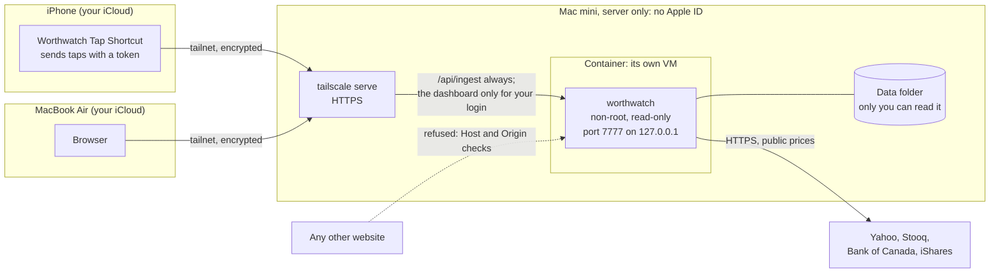
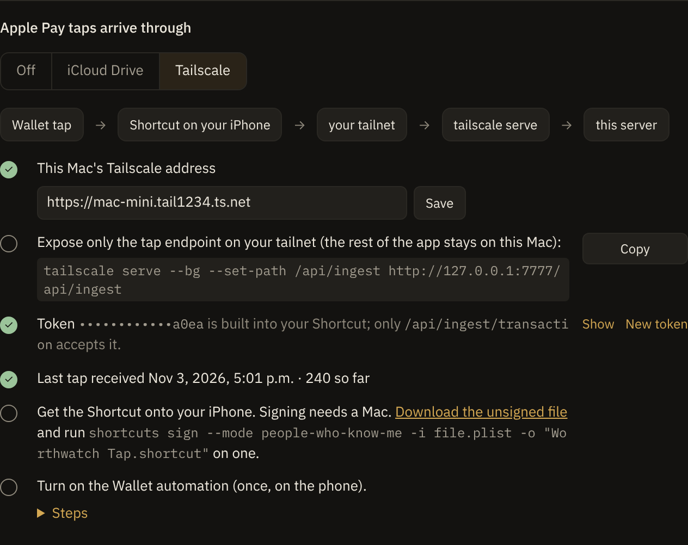

# Keep Worthwatch secure

Worthwatch holds your whole financial picture, so it's built to be safe by default: it listens on your computer only, refuses requests from other websites, and opens nothing but the Apple Pay feed over Tailscale. This page shows you the setup we recommend, what Worthwatch protects without any settings, and the risk that's left.

> [!IMPORTANT]
> Worthwatch has no login. Anything that can reach its port can read and change your data. Every default on this page exists to keep that set small: you, on the computer it runs on.

## How it fits together

The recommended setup runs Worthwatch on a Mac mini used only as a server. The mini isn't signed in to your Apple ID, so a bug in Worthwatch can't reach your passwords, photos or messages, because they aren't there. Your iPhone and laptop reach it over Tailscale.



Nothing on the mini connects to your phone or laptop. The phone only sends; the laptop only opens the dashboard.

## Set up a Mac mini as a Worthwatch server

### Prepare the Mac

1. During setup, skip signing in with your Apple ID. If the Mac is already signed in, open **System Settings**, select your name, and select **Sign Out**.
2. Turn on FileVault in **System Settings › Privacy & Security › FileVault**.
3. Create a standard (not administrator) user for Worthwatch in **System Settings › Users & Groups**. Run Worthwatch as that user.
4. Install [Tailscale](https://tailscale.com/download) from its website (the App Store needs an Apple ID), and sign in to your tailnet.
5. Install a container tool:
   - On Apple silicon, install Apple's [container tool](https://github.com/apple/container/releases). Each container gets its own small VM.
   - Otherwise, install Docker Desktop. In **Settings › Resources › File sharing**, remove every folder you don't need.

### Run Worthwatch in a container

Get the code, then start it. Both scripts publish the port on `127.0.0.1` only and mount nothing but Worthwatch's own data.

- With Apple's container tool, starting at every login:

  ```sh
  ./deploy/macos/install-container.sh
  ```

- With Docker:

  ```sh
  ./deploy/container/run.sh
  ```

  Turn on **Start Docker Desktop when you sign in**. The container restarts by itself.

Open `http://127.0.0.1:7777` on the mini to check that it runs. After a `git pull`, run `./deploy/container/run.sh --rebuild`.

### Send Apple Pay taps over Tailscale

On the mini, share only the tap endpoint with your tailnet:

```sh
tailscale serve --bg --set-path /api/ingest http://127.0.0.1:7777/api/ingest
```

Then follow [Set up the Apple Pay feed](../use/apple-pay-feed.md#use-tailscale) and choose **Tailscale**. The server-only setup can't use the iCloud Drive feed, because the mini has no iCloud.

### Open the dashboard from your laptop or phone

Over Tailscale, Worthwatch answers only the tap endpoint until you tell it who you are.

1. Find your Tailscale login: run `tailscale status --json` and look for `LoginName`, or check the Tailscale app.
2. Start Worthwatch with it:

   ```sh
   WORTHWATCH_TAILSCALE_OWNER=you@example.com ./deploy/macos/install-container.sh
   ```

   With Docker, use `./deploy/container/run.sh` the same way.
3. Share the whole app with your tailnet:

   ```sh
   tailscale serve --bg 7777
   ```

4. Open `https://<mini-name>.<tailnet>.ts.net` on your laptop or phone.

Requests from any other Tailscale login, or from the public internet through Funnel, still reach only the tap endpoint.

### Limit what the mini can reach on your tailnet

By default, every device on your tailnet can reach every other one. Tag the mini and let your devices reach it, but not the other way round. In the [Tailscale admin console](https://login.tailscale.com/admin/acls), add:

```jsonc
{
  "tagOwners": { "tag:server": ["autogroup:admin"] },
  "acls": [
    // Your own devices can reach each other, as before.
    { "action": "accept", "src": ["autogroup:member"], "dst": ["autogroup:self:*"] },
    // Your devices can reach the mini's HTTPS port. The mini can't start a connection to them.
    { "action": "accept", "src": ["autogroup:member"], "dst": ["tag:server:443"] }
  ]
}
```

Then tag the mini: in the admin console, open the mini, select **Edit ACL tags**, and add `tag:server`. Also turn on [device approval](https://tailscale.com/kb/1099/device-approval) so a new device can't join your tailnet without you.

## Check that it's locked down

Run through this list after you set up, and after any change.

- [ ] The mini isn't signed in to your Apple ID, and FileVault is on.
- [ ] Worthwatch runs in a container, as a standard user.
- [ ] `curl -s -o /dev/null -w '%{http_code}\n' -H 'Host: example.com' http://127.0.0.1:7777/api/view` prints `421`.
- [ ] From another device on your Wi-Fi, `http://<mini's IP>:7777` doesn't load.
- [ ] `tailscale serve status` lists only `/api/ingest`, or the whole app with `WORTHWATCH_TAILSCALE_OWNER` set.
- [ ] `tailscale funnel status` lists nothing.
- [ ] **Settings** shows the token as dots and its last four characters.
- [ ] Worthwatch isn't in **System Settings › Privacy & Security › Full Disk Access**.
- [ ] Dependabot alerts are on for the repository. When one arrives, update and run `./deploy/container/run.sh --rebuild`.

## What Worthwatch protects by default

You don't need to set anything for these.

| What could happen | What stops it |
|---|---|
| A website you visit reads or changes your data by pointing its own name at `127.0.0.1` (DNS rebinding). | Worthwatch answers only requests addressed to `localhost`, an IP address, a `*.ts.net` name, or a name in `WORTHWATCH_ALLOWED_HOSTS`. Others get `421`. |
| A website makes your browser send a form to approve a proposal, make a new token, or make backups. | Every request that changes something, and every API read, must come from Worthwatch's own page. Others get `403`. |
| A website shows Worthwatch in a hidden frame to trick you into a click. | The page refuses to load in a frame, and loads scripts only from Worthwatch itself. |
| Another device on your tailnet, or the internet through Funnel, opens the dashboard. | Over Tailscale, only `/api/ingest` answers, unless the request carries your Tailscale login. |
| Something that can read the Settings page takes the Apple Pay token. | Settings shows only its last four characters. The whole token needs a request from Worthwatch's own page. |
| Another user on the computer reads your files. | The data folder is readable by its owner only, and every file Worthwatch writes too. |
| A strange bank statement, holdings file or price reply crashes a screen. | Every parser that reads outside files is tested against mutated real files and junk. |
| Many backups in a row push out older ones. | Worthwatch keeps the newest 30 backups and the newest one of each of the last 30 days. |
| A bug in Worthwatch reaches the rest of the computer. | In a container, it runs as a non-root user with a read-only system, no Linux capabilities, and only its data folder mounted. |
| A dependency has a known vulnerability. | CI checks crates and npm packages against the advisory databases weekly, and Dependabot opens updates. |
| Someone on the network reads or changes traffic (man in the middle). | The browser talks to Worthwatch inside the computer. Tailscale encrypts everything between devices. Price and FX fetches use HTTPS with Worthwatch's own list of trusted certificate authorities. |

The Apple Pay token stays hidden until you select **Show**:

<picture>
  <source media="(prefers-color-scheme: light)" srcset="../screenshots/settings/security-token-hidden-light.png">
  
</picture>

## Understand the risk that's left

No setup makes risk zero. Here is what remains, so you can decide.

- **No login.** Anything running on the mini, under any user, can reach `127.0.0.1:7777`. On a server-only mini that's just you. Don't install other software there.
- **Network mode opens everything.** `WORTHWATCH_BIND=0.0.0.0`, or `WORTHWATCH_HOST=0.0.0.0` in Docker, lets every device on your Wi-Fi read and change your data over plain HTTP. Use Tailscale instead.
- **Your Tailscale account is a key.** Whoever signs in as you can join your tailnet. Protect that account with two-factor authentication, and turn on device approval.
- **The Shortcut carries the token.** Anyone with your Shortcut file can add fake purchases, but can't read anything. Don't share it. If you think it leaked, select **New token** in **Settings** and install the Shortcut again.
- **Updates are manual.** Worthwatch doesn't update itself. A fix reaches you when you pull and rebuild.
- **The container tool is part of the wall.** Apple's container tool is new, and Docker Desktop shares one VM between containers. Both depend on Apple's virtualization being sound.
- **Some features send data out, when you ask.** Cloud chat sends your figures to Anthropic after you approve the preview. An AI assistant connected through [MCP](mcp.md) sends what it reads to that assistant's provider.
- **Backups aren't encrypted.** A backup file holds your whole ledger. Keep copies in an encrypted place, such as an encrypted disk image.
- **The native install runs as you.** `deploy/macos/install.sh` runs Worthwatch as your user, without a container. Use it only on a Mac that holds nothing else you care about, and never give it Full Disk Access.

## Settings that change what's allowed

| Variable | Default | What it does |
|---|---|---|
| `WORTHWATCH_BIND` | `127.0.0.1:7777` | Address Worthwatch listens on. Anything but `127.0.0.1` logs a warning. |
| `WORTHWATCH_ALLOWED_HOSTS` | unset | Extra host names to accept besides `localhost`, IP addresses and `*.ts.net`, comma separated. |
| `WORTHWATCH_TAILSCALE_OWNER` | unset | Tailscale logins that may open the whole app through `tailscale serve`, comma separated. Unset: tap endpoint only. |
| `WORTHWATCH_TAPS_DIR` | unset | Folder the iCloud Apple Pay feed reads from. In a container, mount only the Worthwatch taps folder there, read-only. |
