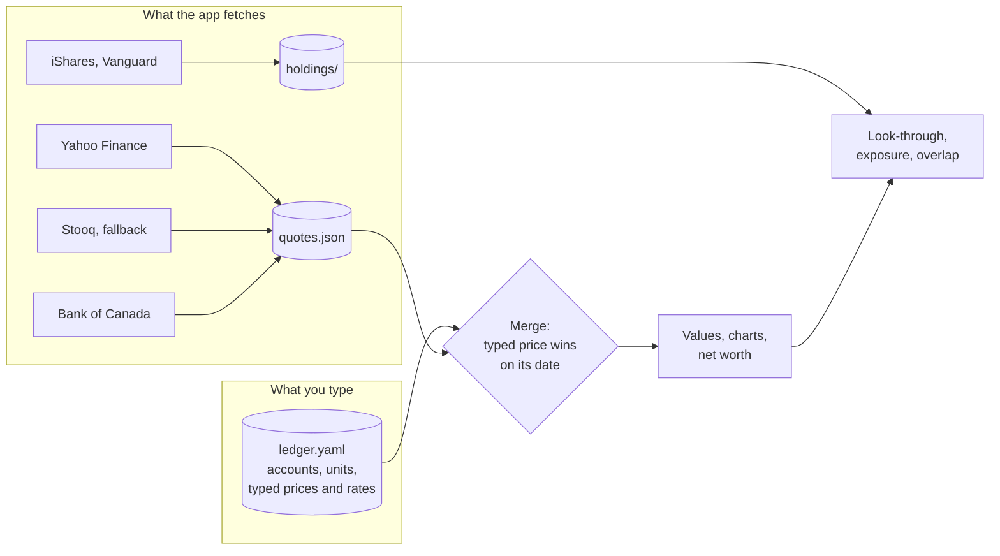

# Prices, FX and fund holdings

Worthwatch fetches public market data so you don't have to type prices. This page explains what it fetches, where it stores the results, and how to override them.

Worthwatch never sends your balances or holdings anywhere. Requests name a symbol or a currency only.

## How it works



- **`ledger.yaml`** holds what you typed. Only you and approved changes write to it.
- **`quotes.json`** holds fetched prices and rates. You can delete it at any time. The next refresh rebuilds it.
- **`holdings/`** holds fund holdings files, one per fund per disclosure date.

## Prices

| Source | Setting | Notes |
|---|---|---|
| [Yahoo Finance](https://finance.yahoo.com) | `prices: yahoo` (default) | Daily closes. Fetches a year of history the first time a symbol appears. |
| [Stooq](https://stooq.com) | `prices: stooq` | Daily closes. Use it if Yahoo stops working. |
| None | `prices: off` | Type prices yourself. |

Write symbols in Yahoo's spelling, such as `XEQT.TO` for a TSX listing or `VTI` for a US listing. The Stooq source converts them.

Worthwatch fetches on startup and then once a day. To fetch now, select **Refresh** in the price line at the top of Home.

### Type a price yourself

Add a dated price under `prices`. A typed price always wins for its date:

```yaml
prices:
  XEQT.TO:
    2026-10-31: 34.12
```

## Exchange rates

The [Bank of Canada Valet API](https://www.bankofcanada.ca/valet/docs) supplies a daily rate for each currency you hold. Its rates are against CAD.

```yaml
settings:
  providers: { fx: bank_of_canada }   # bank_of_canada | off
```

### Type a rate yourself

Set a rate under `settings.fx`. Worthwatch uses it when no fetched rate covers a date:

```yaml
settings:
  fx:
    USD: 1.38
```

If your base currency isn't CAD, set `fx: off` and type every rate.

## Fund holdings

Portfolio, the fund and company pages, and Changes need to know what each fund holds.

Worthwatch fetches holdings files from iShares (Canada and US) for every fund you hold, and for funds inside those funds, up to three levels. It checks for a new file every 30 days. Each new disclosure date is saved as a new file and old files are never rewritten, so Changes can compare a fund's holdings over time.

### Add a fund that isn't fetched

For Vanguard or another issuer, add the holdings file URL:

```yaml
settings:
  holdings_urls:
    VFV.TO: https://example.com/path/to/holdings.json
```

Or download the file yourself and drop it in the holdings folder, named after the symbol:

```text
data/holdings/VFV.TO.csv
```

Worthwatch reads iShares and Vanguard CSV files and Vanguard JSON files. It uses the file's own date, or the file's modified time if the file has none. This works fully offline.

## Missing data

Worthwatch never treats a missing price as zero.

- A holding with no price shows **no price**.
- An account in a currency with no rate shows **no FX**.
- A stale price keeps its date on screen.

The price line at the top of Home lists the price date, the rates in use, and any fetch errors.

## Work offline

Set `WORTHWATCH_OFFLINE=1` to stop all fetching. Worthwatch then runs on typed prices and on anything it fetched before, and says so on screen.
