# User guide

This page explains what each screen shows and how to use it. Every screen reads the same ledger, so a change on one screen shows up on all of them right away.

## Home

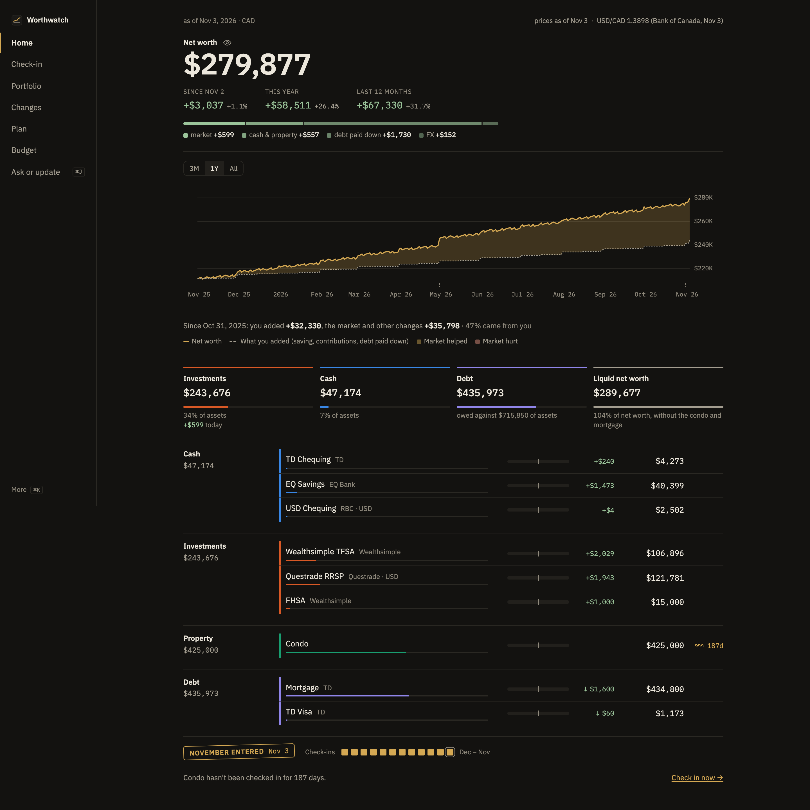

Home answers "what am I worth, and is it going up?"

- The large figure is your net worth in your base currency. Below it are three changes: since your last check-in, this year, and the last 12 months, each in dollars and percent.
- The strip under the changes splits the change since your last check-in into market moves, cash and property, debt paid down, and FX. Hover a part to light the accounts it came from.
- The chart draws your net worth against what you put in yourself (saving, contributions and debt paid down), so the gap between the lines is what the market added. Hover any day to read both lines and the gap.
- The group totals show investments, cash, debt and liquid net worth, each with its share of your assets. Each colour means the same group on every screen.
- Each account row has a sparkline, its value, and how many days since you last updated it. Select a row to open the account's history.

Stale accounts appear in a banner at the top. Select **Check in now** to update them.

## Check-in

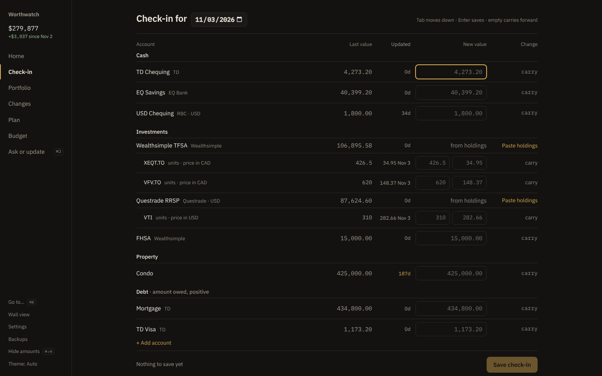

Use Check-in once a month to record balances.

1. Set the date at the top. It defaults to today.
2. Type each account's new balance. The preview shows the change for each account and for net worth.
3. Select **Save check-in**.

### Update investment holdings

For an investment account, select **Paste holdings**. Copy the holdings table from your broker's website and paste it in. Worthwatch shows each symbol, the units before and after, and lines it skipped. Select **Apply** to save.

Worthwatch values holdings from fetched prices. You don't need to type a value for an investment account.

## Portfolio

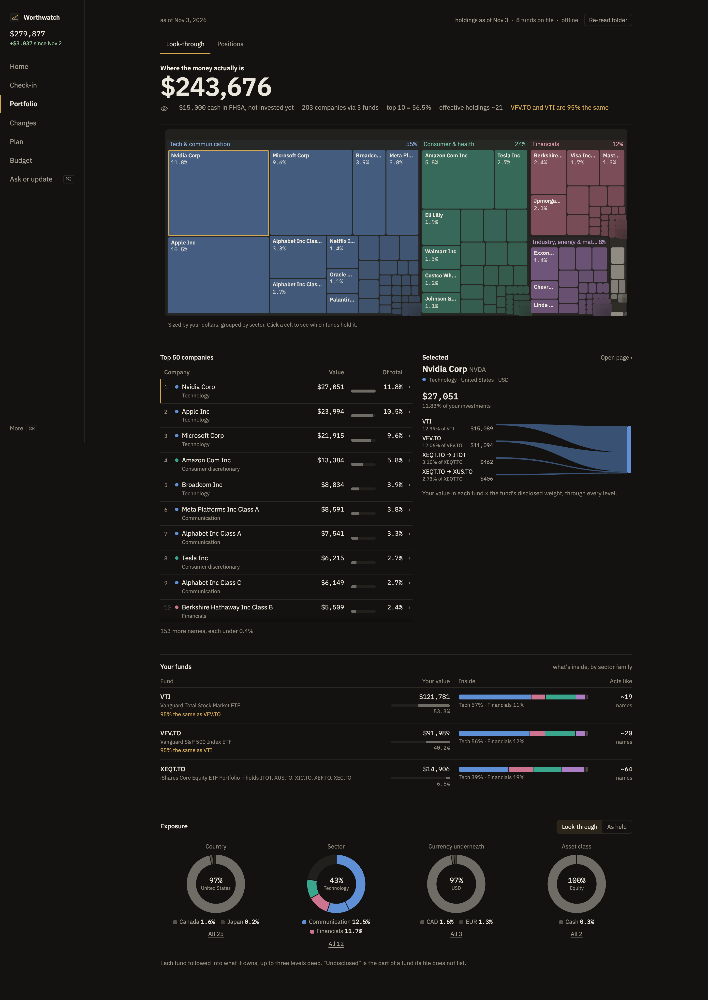

Portfolio opens on **Look-through**: the companies you own through your funds. A fund that holds other funds, such as XEQT, is opened up to three levels deep. **Positions**, the second tab, lists units, prices and gains.

### Find what you really own

- The treemap sizes each company by your dollars in it. Select a tile or a row in **Top companies** to see which funds carry it, in **Selected**.
- **Top companies** lists your 50 biggest. The list scrolls inside its card.
- An amber note under the total flags two funds that hold mostly the same things, such as `VFV.TO and VTI are 95% the same`.

### Compare your funds

**Your funds** shows one row per fund:

- **Your value**, with its share of your investments.
- **Inside**: the fund split by sector family, in the treemap's colours.
- **Acts like**: how many equal-sized names the fund spreads risk across.

A missing or old holdings file is flagged on the fund's row.

### Check your exposure

**Exposure** shows country, sector, currency and asset class as one donut each, with the biggest share in the middle. Select **All** to list every bucket. Switch between **Look-through** (through every fund) and **As held** (each fund as one line).

Fund holdings come from the issuers' published files. See [Prices, FX and fund holdings](data-sources.md#fund-holdings).

## Open a fund or company

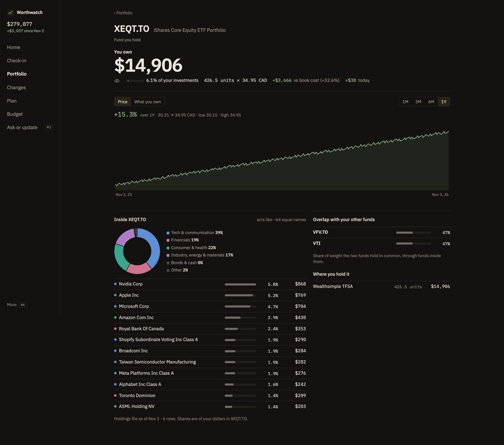

Select any fund or company name on Portfolio, Changes or <kbd>⌘</kbd> <kbd>K</kbd> to open its page.

- **You own**: your dollars in it today, through every fund, and its share of your investments.
- **Price**: a year of closes for anything you hold. For a company inside your funds, Worthwatch looks the price up when you open the page (never when offline).
- **What you own**: your dollars in it at each check-in. Before your first holdings file, that file's weights stand in, and the page says so.
- A fund's page shows its sector mix as a donut, lists what's inside it, and shows its overlap with your other funds. A company's page shows which of your funds it comes through.

## Changes

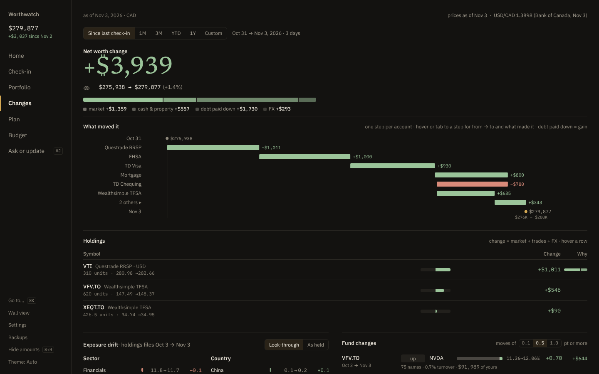

Changes shows what moved in your investments between two dates, told through your funds. Net worth by account stays on Home; Changes links to it.

1. Pick a period: **Since last check-in**, **1M**, **3M**, **YTD**, **1Y**, or enter custom dates.
2. Read the tiles: one per fund, with its price line over the period, the % move, your dollars gained or lost, and units you bought or sold. Select a tile to open the fund's page.
3. Look underneath: your dollars in each company and sector, through every fund.
4. Look at **Inside your funds** for what each fund bought and sold itself.

Moves smaller than the threshold are counted but not listed. Change the threshold at the top of **Inside your funds**.

## Chat

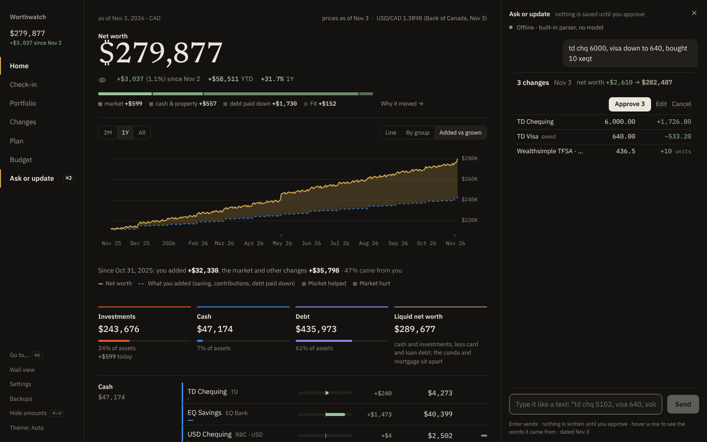

Chat lets you update balances the way you would text a friend. It opens as a drawer over any screen: select **Ask or update** in the sidebar, or press <kbd>⌘</kbd> <kbd>J</kbd> (<kbd>Ctrl</kbd> <kbd>J</kbd>). For example:

- `td chq 5102, visa down to 640, sold 20 XEQT in the TFSA`
- `eq savings 18.5k`
- `coffee 6 cash` or `lunch 18.40 on td visa`
- `what is my net worth?`

Each message becomes a card. The card lists every change with the current value, the new value, and the effect on net worth.

- Select **Approve** to save the changes.
- Select **Edit** to correct a figure first.
- Select **Cancel** to discard the card.

Nothing is saved until you approve. If part of a message doesn't match your accounts, that line is shown as rejected with the reason.

A purchase, such as `coffee 6 cash`, goes to your budget instead of a balance. Its card says **budget only · net worth unchanged**, and approving it adds the purchase as if you'd used **+ Add** on **Budget**. Use `cash`, or the name of a bank account or card you paid with.

<picture>
  <source media="(prefers-color-scheme: light)" srcset="../screenshots/chat/chat-spend-light.png">
  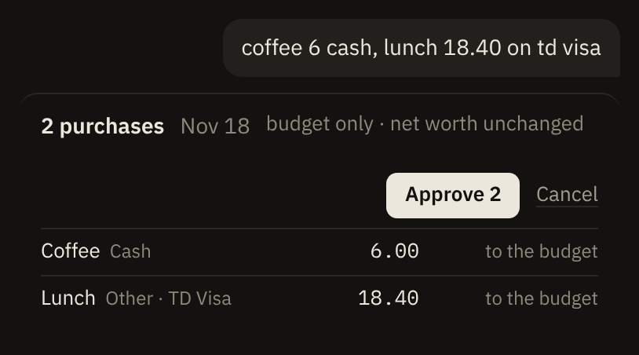
</picture>

Chat works without any model. To choose a local model or Claude, see [Configure Worthwatch](configuration.md#choose-the-chat-model). Proposals from Claude Desktop and other MCP clients also appear here as cards. See [Connect an AI assistant](../run/mcp.md).

## Plan

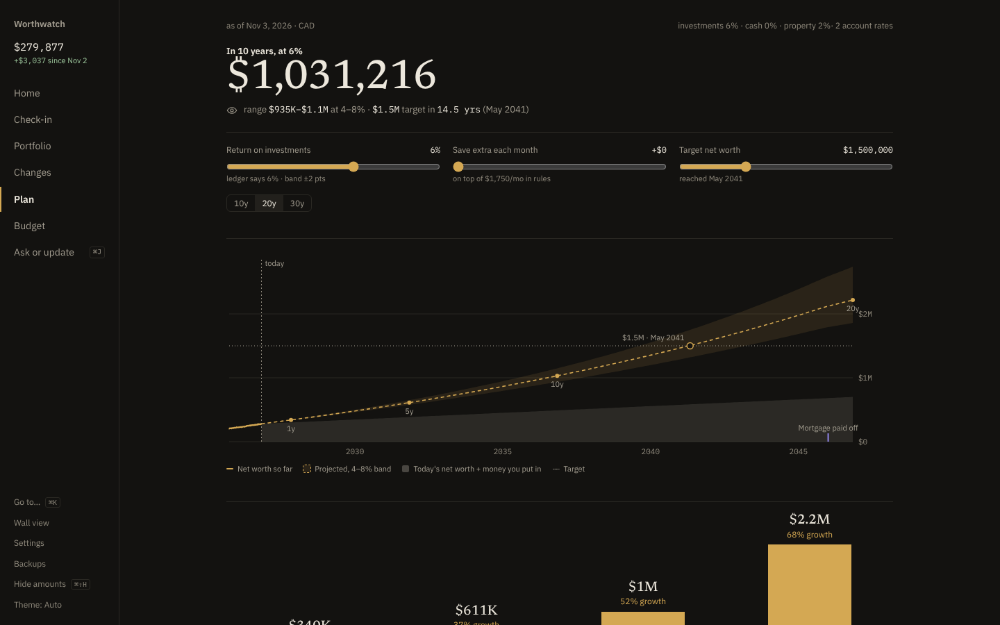

Plan projects your net worth forward.

- The fan chart shows the projection at your assumed return, with a band 2 points above and below.
- The sliders try a different return, extra monthly saving, or a target. They don't change your ledger. Select **Save as my defaults** to keep them.
- Debt curves show when each debt is paid off.
- Registered accounts adds up every TFSA, FHSA and RRSP you hold. Each type shows its total value, what you put in and what grew, the room you have left, and a bar per account.

### Set up TFSA and FHSA room

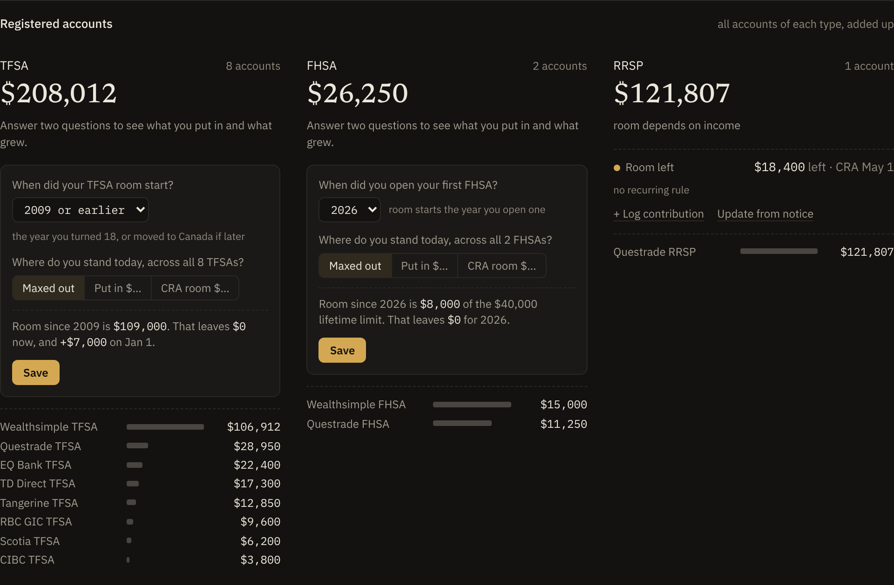

You answer two questions per account type. Worthwatch does the rest with CRA's limits.

1. Pick the year your room started. For a TFSA, that's the year you turned 18, or moved to Canada if later. Pick **2009 or earlier** if both came before 2009. For an FHSA, pick the year you opened your first one.
2. Pick where you stand today across all accounts of that type: **Maxed out**, **Put in $…** (deposits minus withdrawals), or **CRA room $…** (the room CRA My Account shows).
3. Check the preview line, then select **Save**.

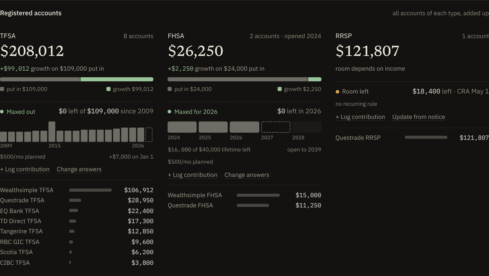

- The TFSA strip has one column per year, as tall as that year's limit and filled as far as you used it. The dashed column is next January's room.
- The FHSA cells are the five $8,000 years toward the $40,000 lifetime limit.
- Select **+ Log contribution** as you put more in. Select **Change answers** to start again from a new figure.

Recurring deposits and payments drive the projection. Add them on the Plan screen or in the ledger. See [Configure Worthwatch](configuration.md#set-up-plan-inputs).

## Budget

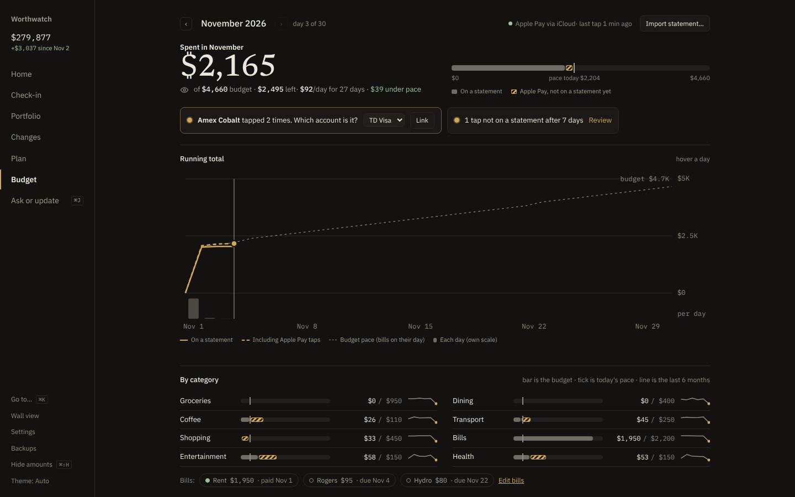

Budget shows one month of spending against your category limits.

- The top shows what you spent, what's left, and how much is taps not on a statement yet.
- The running total compares your spending with your pace. Bills count on their due day, and the rest of the budget is spread evenly.
- Category bars show each limit, with a tick for today's pace. Select a limit to change it.
- Bills show as paid once a statement row matches them.
- Transactions are grouped by day. A hollow dot is an Apple Pay tap waiting for its statement row, and a pencil ✎ is an entry you added by hand. Choose a new category from a row's menu to fix it.

Select **Import statement…** to bring in a CSV or OFX file, or **+ Add** to add a cash purchase by hand. See [Budget your spending](budgeting.md).

## Settings

Select **Settings** at the bottom of the sidebar to set up the Apple Pay feed, choose where each account's transactions come from, and edit bills and category rules. See [Set up the Apple Pay feed](apple-pay-feed.md).

## Wall view

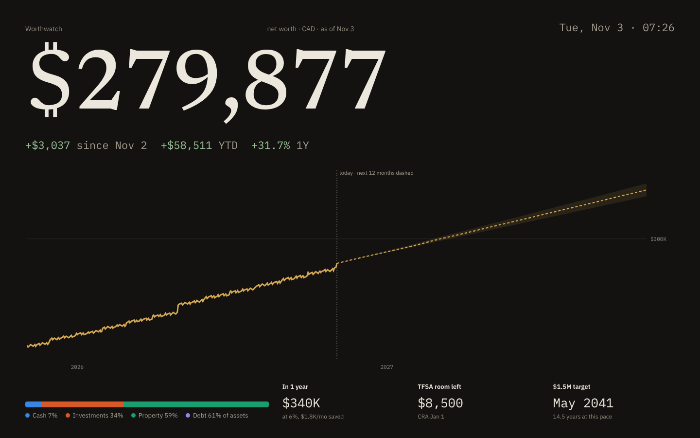

Open `#/wall`, or select **Wall view** in the sidebar, for a full-screen dashboard. Use it on a spare tablet or monitor.

## Shortcuts and display options

| Action | Shortcut |
|---|---|
| Go to any screen or account, or run an action | <kbd>⌘</kbd> <kbd>K</kbd> (<kbd>Ctrl</kbd> <kbd>K</kbd>) |
| Open or close Ask or update (Chat) | <kbd>⌘</kbd> <kbd>J</kbd> (<kbd>Ctrl</kbd> <kbd>J</kbd>) |
| Hide all amounts as `*****`, for screen sharing | <kbd>⌘</kbd> <kbd>⇧</kbd> <kbd>H</kbd> (<kbd>Ctrl</kbd> <kbd>Shift</kbd> <kbd>H</kbd>) |

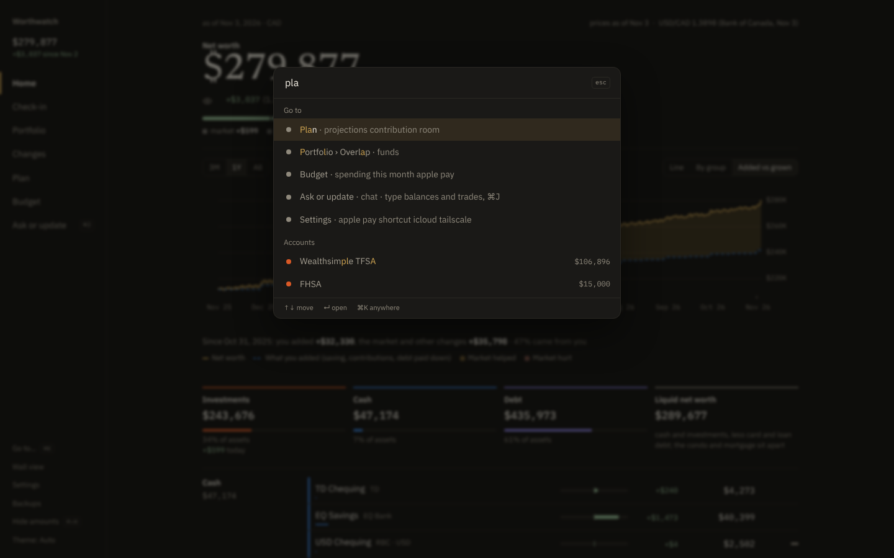

The theme follows your system. To force dark or light, select **Theme** at the bottom of the sidebar.

## Backups

Select **Backups** in the sidebar to make a backup now or download an earlier one. See [Back up and restore](../run/backup-restore.md).
