# User guide

This page explains what each screen shows and how to use it. Every screen reads the same ledger, so a change on one screen shows up on all of them right away.

## Home

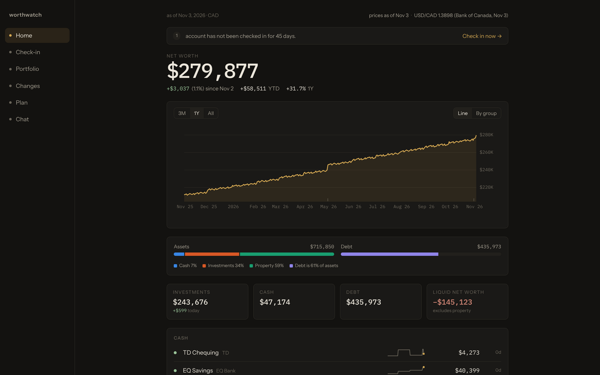

Home answers "what am I worth, and is it going up?"

- The large figure is your net worth in your base currency. Below it are the change since your last check-in, this year, and over one year.
- The chart shows net worth over time. Switch between **Line** and **By group** to see cash, investments, property and debt stacked.
- The bar compares assets to debt, coloured by group. Each colour means the same group on every screen.
- Each account row has a sparkline, its value, and how many days since you last updated it. Select a row to open the account's history.

Stale accounts appear in a banner at the top. Select **Check in now** to update them.

## Check-in

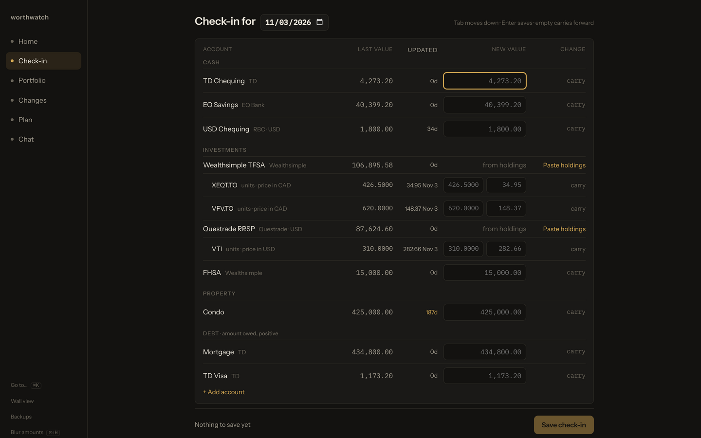

Use Check-in once a month to record balances.

1. Set the date at the top. It defaults to today.
2. Type each account's new balance. The preview shows the change for each account and for net worth.
3. Select **Save check-in**.

### Update investment holdings

For an investment account, select **Paste holdings**. Copy the holdings table from your broker's website and paste it in. Worthwatch shows each symbol, the units before and after, and lines it skipped. Select **Apply** to save.

Worthwatch values holdings from fetched prices. You don't need to type a value for an investment account.

## Portfolio

Portfolio has four tabs: **Positions**, **Look-through**, **Exposure** and **Overlap**.

### Look-through

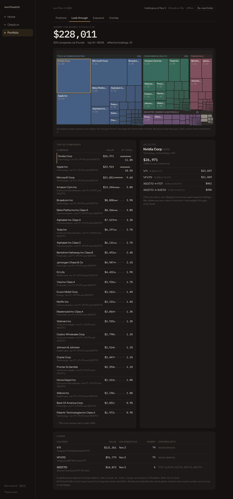

Look-through shows the companies you own through your funds. A fund that holds other funds, such as XEQT, is opened up to three levels deep. Each tile's size is your dollars in that company. Hover a tile for its weight and which funds it came from.

### Exposure

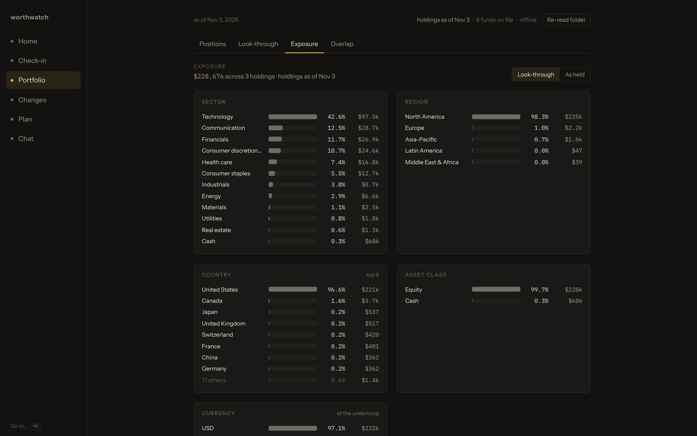

Exposure groups your money by sector, region, country, asset class and currency. Switch between **Look-through** (through every fund) and **As held** (each fund as one line).

### Overlap

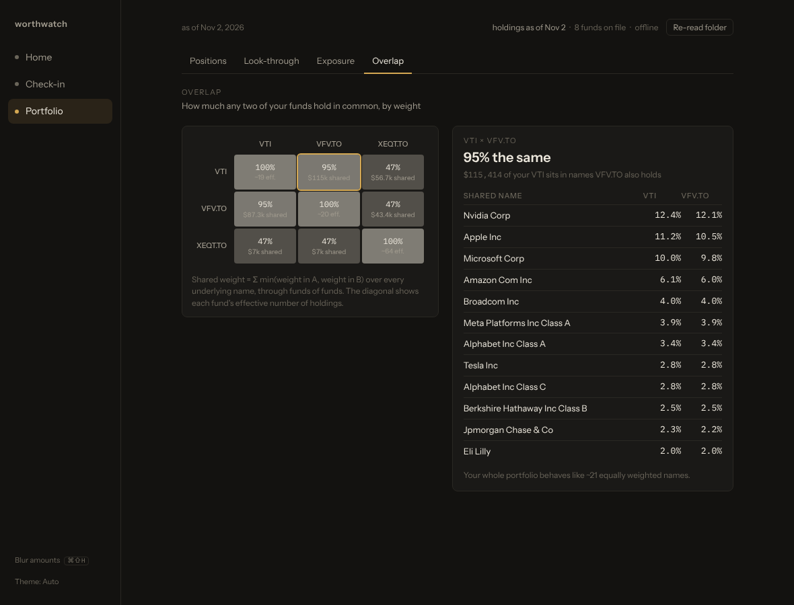

Overlap shows how much each pair of funds holds in common. A high figure means the two funds mostly duplicate each other.

Fund holdings come from the issuers' published files. See [Prices, FX and fund holdings](data-sources.md#fund-holdings).

## Changes

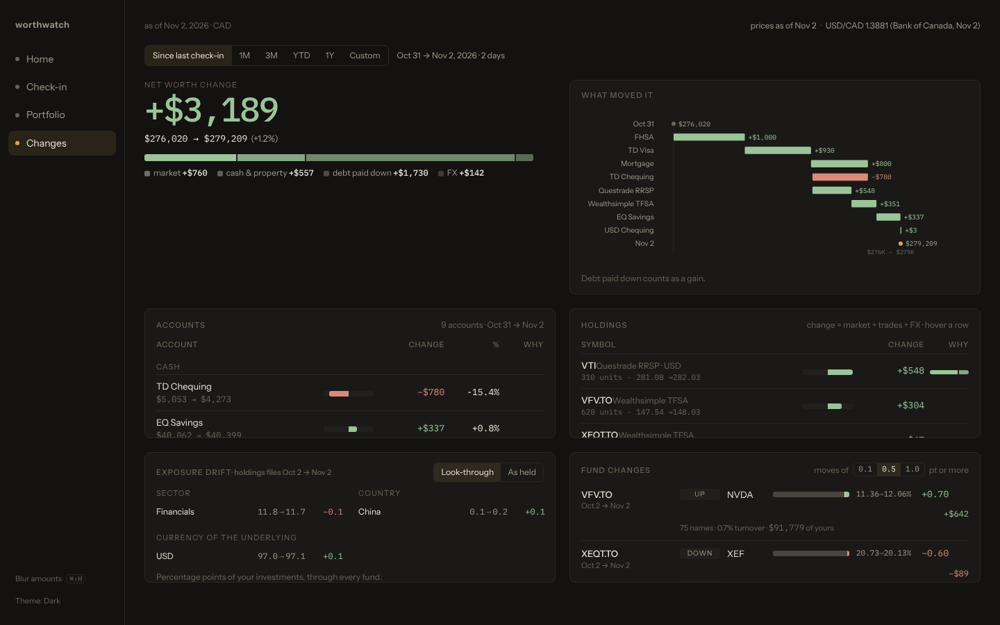

Changes explains the difference between two dates.

1. Pick a period: **Since last check-in**, **1M**, **3M**, **YTD**, **1Y**, or enter custom dates.
2. Read the bridge at the top. It splits the change into market moves, cash and property, debt paid down, and FX.
3. Look at the panels below for each account, each holding, how your exposure drifted, and what your funds added or dropped.

Hover any bar for the exact figures. Moves smaller than the threshold are counted but not listed. Change the threshold at the top of the fund panel.

## Chat

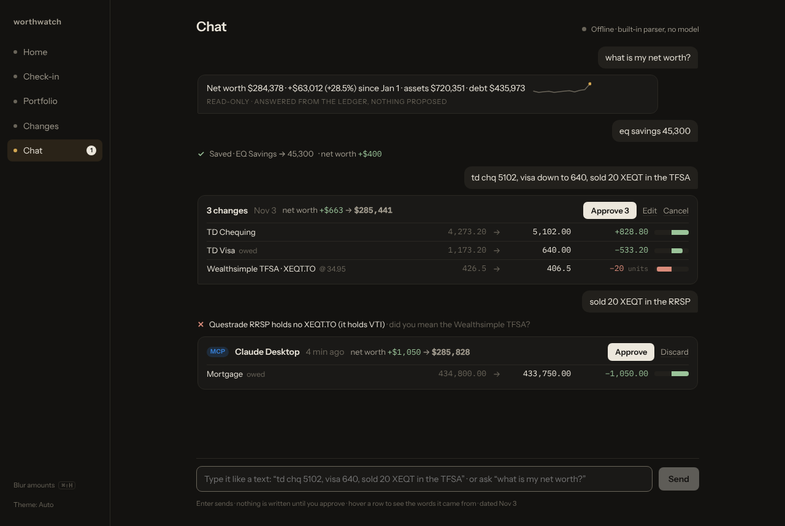

Chat lets you update balances the way you would text a friend. For example:

- `td chq 5102, visa down to 640, sold 20 XEQT in the TFSA`
- `eq savings 18.5k`
- `what is my net worth?`

Each message becomes a card. The card lists every change with the current value, the new value, and the effect on net worth.

- Select **Approve** to save the changes.
- Select **Edit** to correct a figure first.
- Select **Cancel** to discard the card.

Nothing is saved until you approve. If part of a message doesn't match your accounts, that line is shown as rejected with the reason.

Chat works without any model. To choose a local model or Claude, see [Configure Worthwatch](configuration.md#choose-the-chat-model). Proposals from Claude Desktop and other MCP clients also appear here as cards. See [Connect an AI assistant](mcp.md).

## Plan

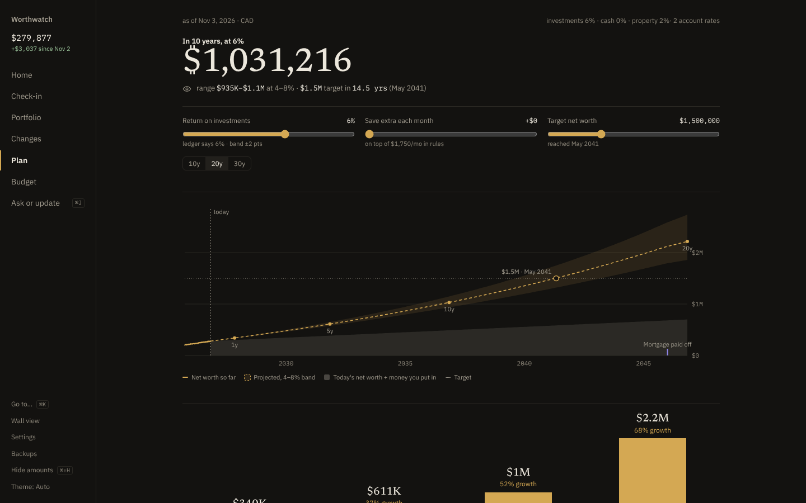

Plan projects your net worth forward.

- The fan chart shows the projection at your assumed return, with a band 2 points above and below.
- The sliders try a different return, extra monthly saving, or a target. They don't change your ledger. Select **Save as my defaults** to keep them.
- Debt curves show when each debt is paid off.
- Room bars show TFSA, RRSP and FHSA contribution room: used, planned to December 31, and left.

Recurring deposits and payments drive the projection. Add them on the Plan screen or in the ledger. See [Configure Worthwatch](configuration.md#set-up-plan-inputs).

## Budget

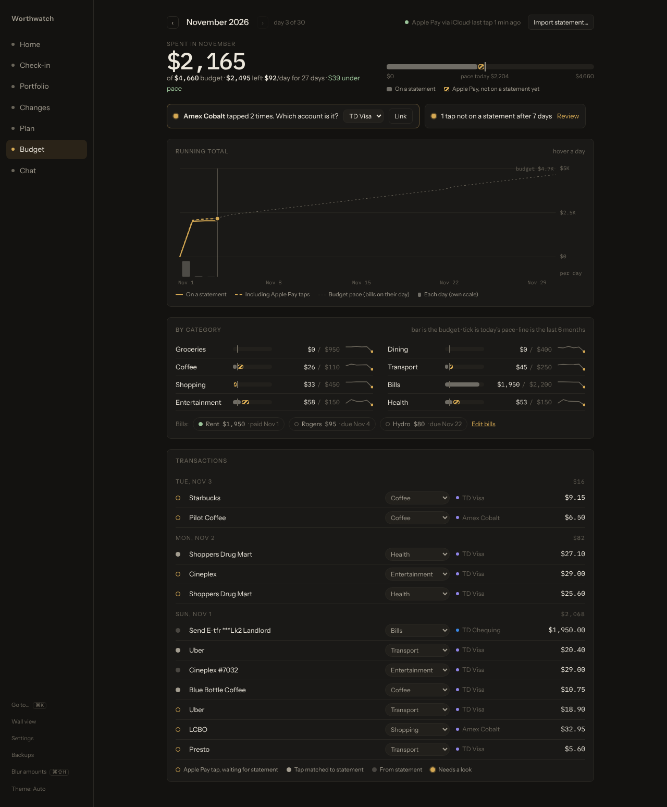

Budget shows one month of spending against your category limits.

- The top shows what you spent, what's left, and how much is taps not on a statement yet.
- The running total compares your spending with your pace. Bills count on their due day, and the rest of the budget is spread evenly.
- Category bars show each limit, with a tick for today's pace. Select a limit to change it.
- Bills show as paid once a statement row matches them.
- Transactions are grouped by day. A hollow dot is an Apple Pay tap waiting for its statement row. Choose a new category from a row's menu to fix it.

Select **Import statement…** to bring in a CSV or OFX file. See [Budget your spending](budgeting.md).

## Settings

Select **Settings** at the bottom of the sidebar to set up the Apple Pay feed, choose where each account's transactions come from, and edit bills and category rules. See [Set up the Apple Pay feed](apple-pay-feed.md).

## Wall view

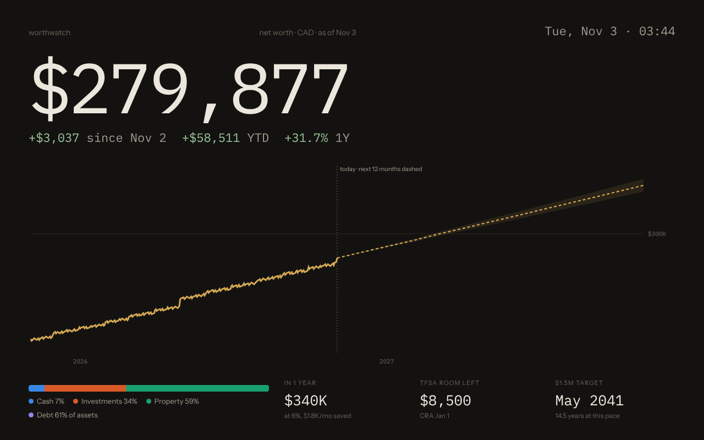

Open `#/wall`, or select **Wall view** in the sidebar, for a full-screen dashboard. Use it on a spare tablet or monitor.

## Shortcuts and display options

| Action | Shortcut |
|---|---|
| Go to any screen or account, or run an action | <kbd>⌘</kbd> <kbd>K</kbd> (<kbd>Ctrl</kbd> <kbd>K</kbd>) |
| Blur all amounts, for screen sharing | <kbd>⌘</kbd> <kbd>⇧</kbd> <kbd>H</kbd> (<kbd>Ctrl</kbd> <kbd>Shift</kbd> <kbd>H</kbd>) |

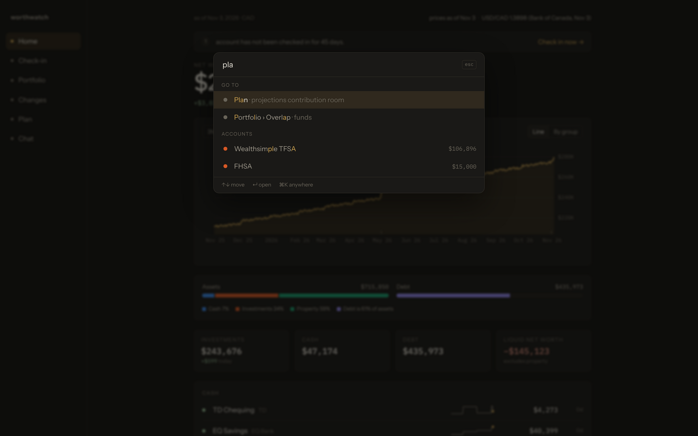

The theme follows your system. To force dark or light, select **Theme** at the bottom of the sidebar.

## Backups

Select **Backups** in the sidebar to make a backup now or download an earlier one. See [Back up and restore](backup-restore.md).
